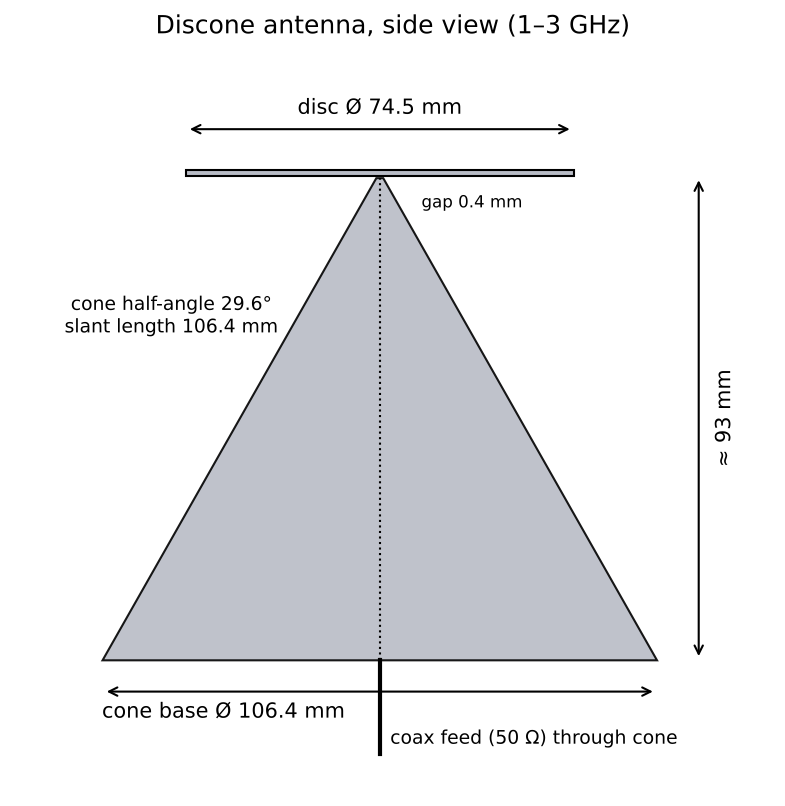

# Discone Antenna (CST Microwave Studio)

[← Back to CST Simulations](../README.md)

**Application:** An ultra-wideband, vertically polarized, omnidirectional antenna for wideband receivers, spectrum monitoring, scanners and EMC measurements.
It keeps a stable input impedance over several octaves with a simple disc-and-cone structure fed by a coaxial line.

## Specifications

| Parameter | Value |
|---|---|
| Structure | PEC disc above a PEC cone, coaxial feed through the cone apex |
| Overall dimensions | Ø 106.4 mm × ≈ 93 mm (cone base Ø 106.4 mm, disc Ø 74.5 mm) |
| Cone | Half-angle 29.6°, slant length 106.4 mm, apex diameter 1.33 mm |
| Disc–cone gap | 0.4 mm; metal thickness 0.15 mm |
| Excitation | 50 Ω coaxial port |
| Solver | CST MWS time-domain solver, hexahedral mesh (~61k cells) |
| Frequency range | 1–3 GHz (L and S bands), centre 2 GHz |
| Simulated outputs | VSWR, maximum gain vs frequency |
| Year of design | Model from the MAGUS Antenna Designer template (2009), saved in CST 2016 |
