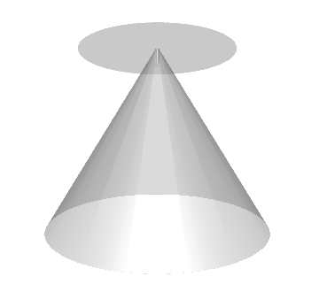
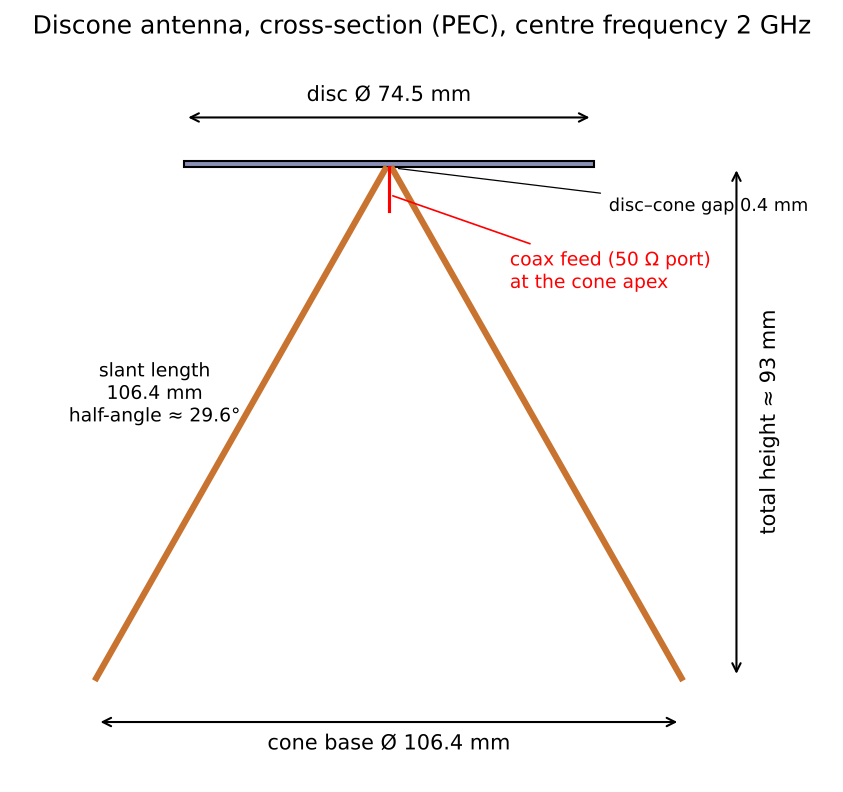

# Discone Antenna (CST Microwave Studio)

[← Back to CST Simulations](../README.md)

**Application:** A very wideband omnidirectional, vertically polarized antenna for scanners, spectrum monitoring and multi-band base stations.
It keeps its input impedance over several octaves with a simple disc-and-cone structure.

## Specifications

| Parameter | Value |
|---|---|
| Structure | PEC disc above a PEC cone, coaxial feed at the cone apex |
| Overall dimensions | Disc Ø 74.5 mm, cone base Ø 106.4 mm, slant length 106.4 mm, cone half-angle ≈ 29.6°, total height ≈ 93 mm |
| Feed | Disc–cone gap 0.4 mm, feed pin radius 0.27 mm, metal thickness 0.15 mm, waveguide port (50 Ω) |
| Solver | CST MWS time-domain solver, hexahedral mesh (≈ 61k cells), two magnetic symmetry planes |
| Frequency range | 1–3 GHz (centre 2 GHz), L and S bands |
| Year of design | 2016 (CST MWS 2016; geometry from a MAGUS Antenna Designer template) |
