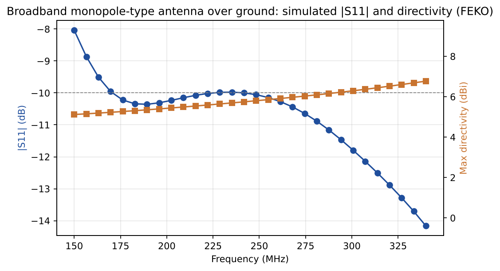
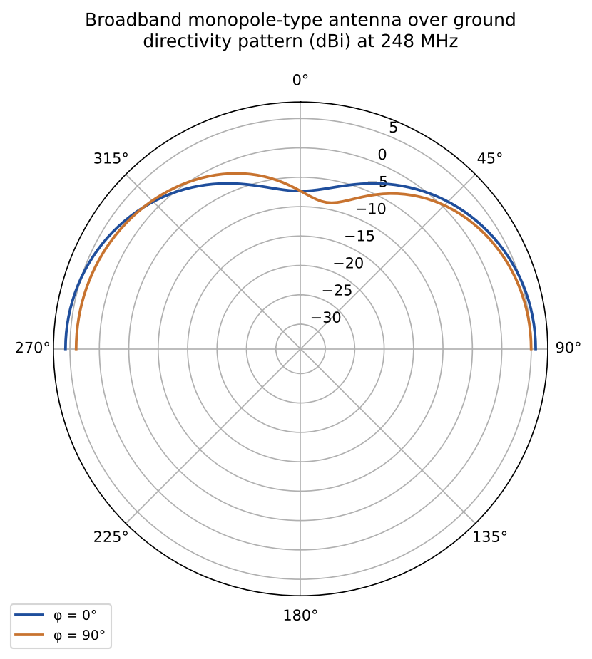

# Broadband Monopole-Type Antenna over Ground, VHF/UHF (FEKO)

[← Back to FEKO Simulations](../README.md)

**Application:** An omnidirectional, vertically polarized broadband antenna for VHF/UHF communication (vehicle, base-station and tactical radios around 150–340 MHz).
It radiates toward the horizon over an infinite ground plane, with roughly constant matching over about a 2:1 bandwidth.

## Specifications

| Parameter | Value |
|---|---|
| Structure | Surface (triangle-meshed) monopole-type radiator over an infinite PEC ground plane; 252 metallic triangles, metal area ≈ 0.107 m² |
| Excitation | Edge voltage source at the ground connection, 50 Ω reference |
| Frequency range | 150–340 MHz (VHF / lower UHF) |
| Matching | \|S11\| ≈ −10 dB or better from 176 to 340 MHz (best −14 dB at 340 MHz) |
| Directivity | 5.1–6.8 dBi, maximum toward the horizon |
| Year of design | 2016 (FEKO Suite 7.0) |
