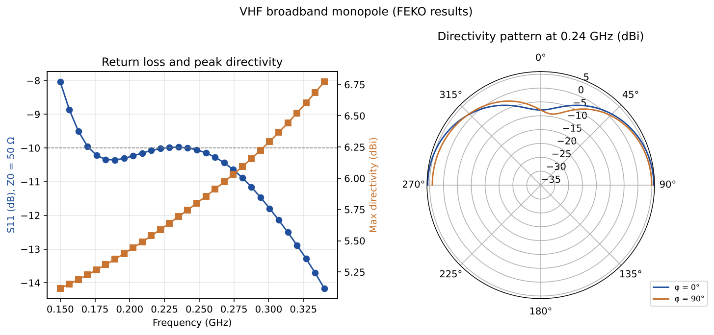

# Broadband Planar Monopole over Ground, VHF (FEKO)

[← Back to FEKO Simulations](../README.md)

**Application:** A wideband, vertically polarized, omnidirectional antenna for VHF/low-UHF communications, broadcast monitoring and military/tactical radio (about 150–340 MHz).
The tapered (V-shaped) feed region of the flat plate gives a much wider bandwidth than a thin wire monopole.

## Specifications

| Parameter | Value |
|---|---|
| Structure | Flat metal plate monopole with a V-tapered feed, over an infinite PEC ground plane |
| Overall dimensions | 400 mm wide × 353 mm high (V-taper 300 mm wide, 80 mm high; 3 mm feed gap) |
| Excitation | 50 Ω edge voltage source |
| Solver | FEKO 7.0 method of moments, 252 triangles |
| Frequency range | 150–340 MHz (VHF / low UHF); S11 ≈ −10 dB or better from ~170 MHz up |
| Peak directivity | 5.1–6.8 dBi (maximum at the horizon, vertical polarization) |
| Simulated outputs | Input impedance, S11, elevation and azimuth patterns |
| Year of design | 2016 (FEKO Suite 7.0) |
