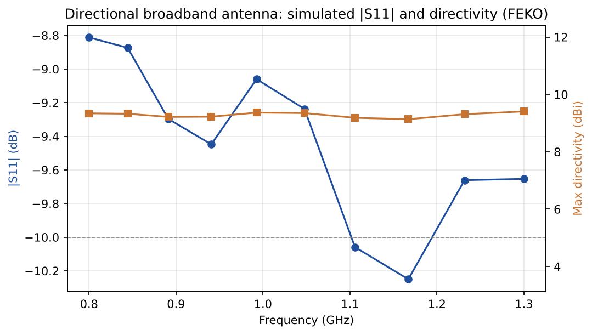
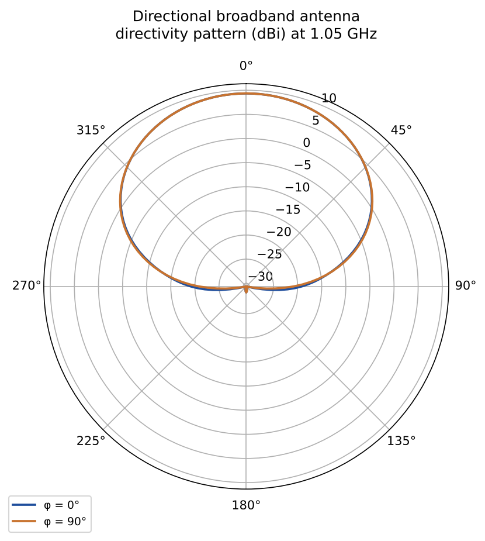

# Directional Broadband Antenna, 0.8–1.3 GHz (FEKO)

[← Back to FEKO Simulations](../README.md)

**Application:** A directional antenna with nearly constant gain and a symmetric beam across UHF/L band, for point-to-point links, EMC testing and as a reflector feed.
Its high front-to-back ratio keeps radiation behind the antenna low.

## Specifications

| Parameter | Value |
|---|---|
| Structure | Surface (triangle-meshed) PEC antenna in free space; 2,588 metallic triangles, metal area ≈ 0.183 m² |
| Excitation | Edge voltage source, 50 Ω reference |
| Frequency range | 0.8–1.3 GHz (UHF / L band) |
| Input impedance | ≈ 90–100 Ω across the band (\|S11\| ≈ −9 to −10 dB at 50 Ω) |
| Directivity | 9.1–9.4 dBi; at 1.05 GHz HPBW ≈ 68° in both principal planes, front-to-back ≈ 39 dB |
| Year of design | 2016 (FEKO Suite 7.0) |
