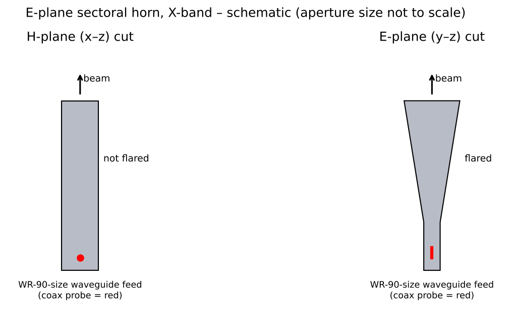
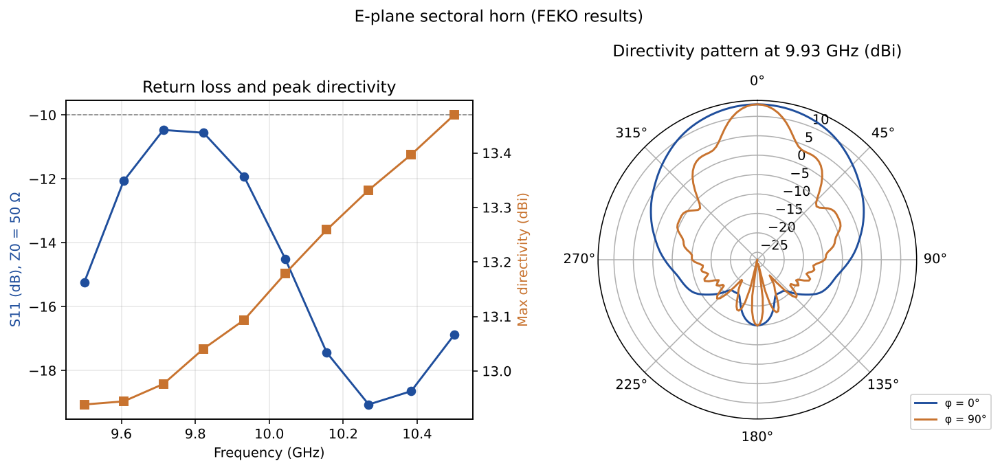

# E-Plane Sectoral Horn, X-Band (FEKO)

[← Back to FEKO Simulations](../README.md)

**Application:** A medium-gain directional antenna for X-band radar, test and measurement, and as a feed for reflector antennas.
Flaring only the E-plane gives a fan-shaped beam: narrow in the E-plane and wide in the other plane.

## Specifications

| Parameter | Value |
|---|---|
| Structure | Rectangular waveguide flared in the E-plane only, fed by a coaxial probe (pin) in the waveguide |
| Mesh | FEKO MoM, 3908 metallic triangles plus a short wire feed pin |
| Excitation | 50 Ω voltage source on the feed pin |
| Frequency range | 9.5–10.5 GHz (X band) |
| Return loss | S11 ≤ −10.5 dB over the whole band (best −19 dB at 10.27 GHz) |
| Peak directivity | 12.9–13.5 dBi |
| Half-power beamwidth | ≈ 20° (E-plane) / ≈ 66° (H-plane) |
| Year of design | 2017 (FEKO Suite 7.0.2) |
