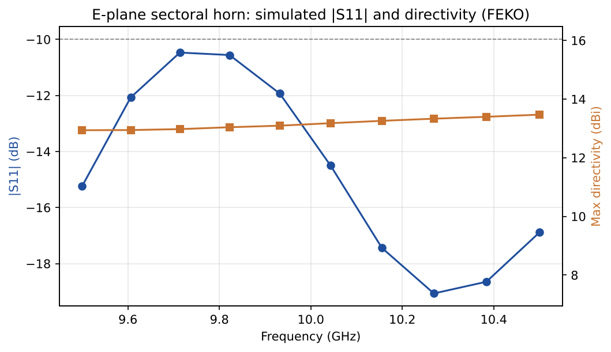
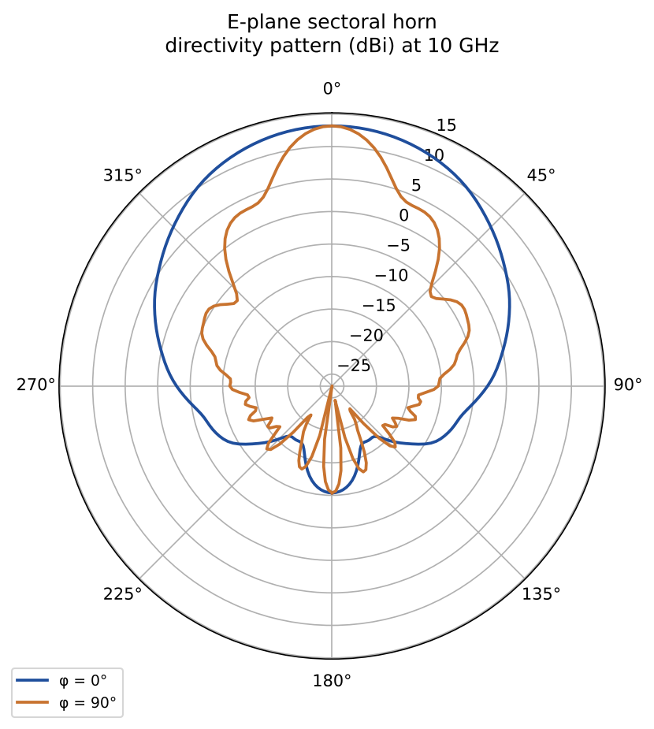

# E-Plane Sectoral Horn, X-Band (FEKO)

[← Back to FEKO Simulations](../README.md)

**Application:** A medium-gain directional antenna for X-band radar, test ranges and as a feed for reflector antennas.
Flaring only in the E-plane gives a narrow beam in that plane and a wide beam in the other, which suits fan-beam coverage.

## Specifications

| Parameter | Value |
|---|---|
| Structure | Rectangular waveguide flared in the E-plane, fed by a coaxial pin (monopole probe) |
| Solver | FEKO MoM with MLFMM, YZ-plane magnetic symmetry, 3,908 metallic triangles |
| Excitation | Voltage source on the feed pin, 50 Ω reference |
| Frequency range | 9.5–10.5 GHz, X band |
| Matching | \|S11\| < −10 dB over the whole band (best −19 dB at 10.27 GHz) |
| Directivity | 12.9–13.5 dBi; at 10 GHz HPBW ≈ 20° (E-plane) × 64° (H-plane), front-to-back ≈ 23 dB |
| Year of design | 2017 (FEKO Suite 7.0.2) |
