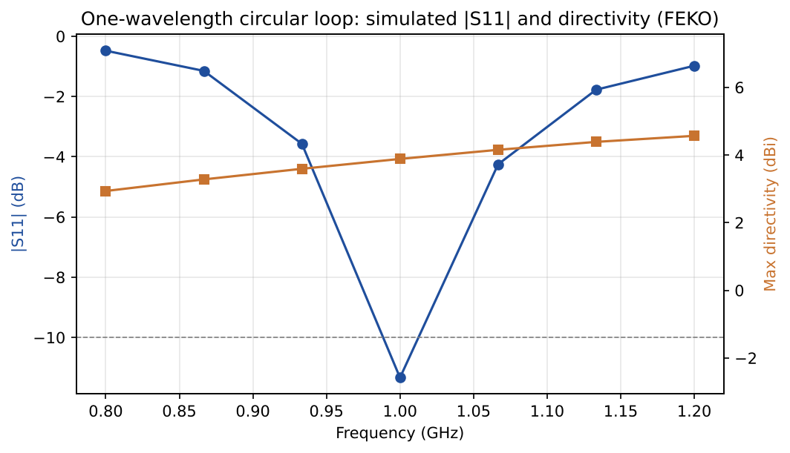
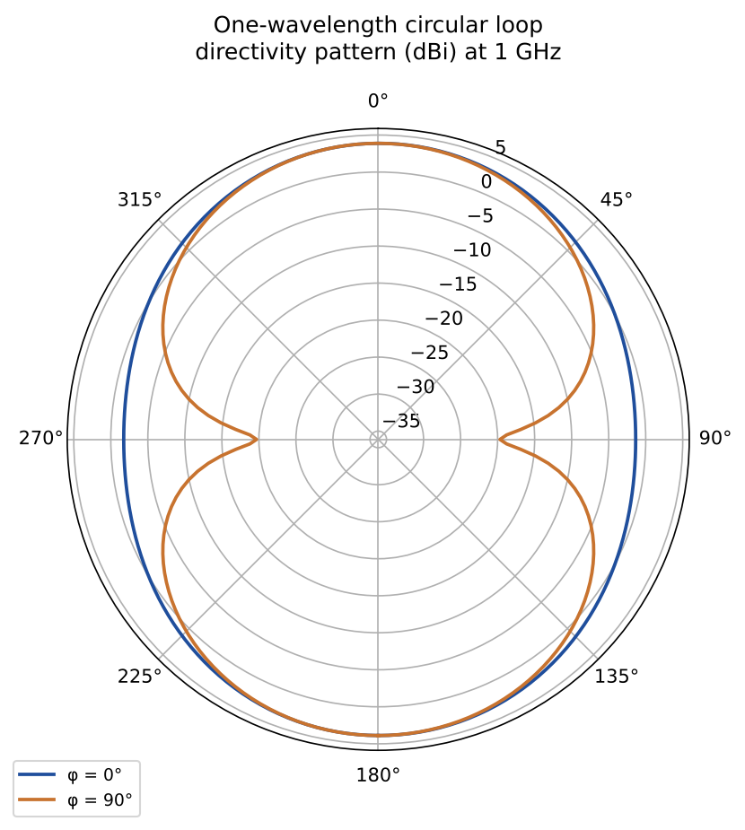

# One-Wavelength Circular Loop Antenna (FEKO)

[← Back to FEKO Simulations](../README.md)

**Application:** A resonant wire loop used in UHF/L-band links and as the radiating element of loop arrays and quad antennas.
At one wavelength circumference it radiates broadside to the loop plane with moderate gain.

## Specifications

| Parameter | Value |
|---|---|
| Structure | Thin-wire circular loop, radius ≈ 48 mm (circumference ≈ 0.30 m), 15 wire segments |
| Excitation | Voltage source at a wire node, 50 Ω reference |
| Frequency range | 0.8–1.2 GHz sweep (UHF / lower L band) |
| Resonance | 1.0 GHz: \|S11\| = −11.3 dB, Z ≈ 86 − j6 Ω |
| Directivity | ≈ 3.9 dBi at 1 GHz, maximum normal to the loop plane |
| Year of design | 2016 (FEKO Suite 7.0) |

The loop radius is inferred from the feed position and direction in the output file.
