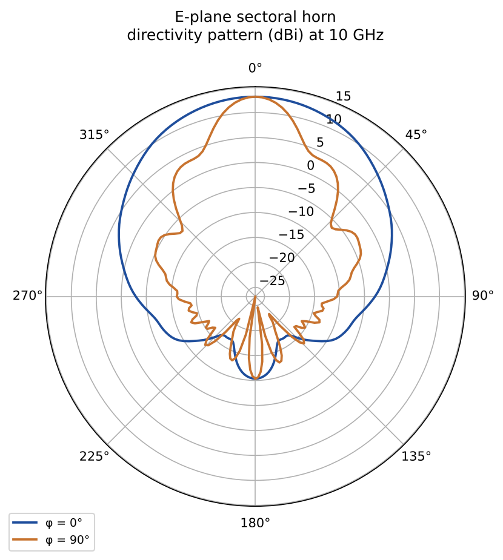
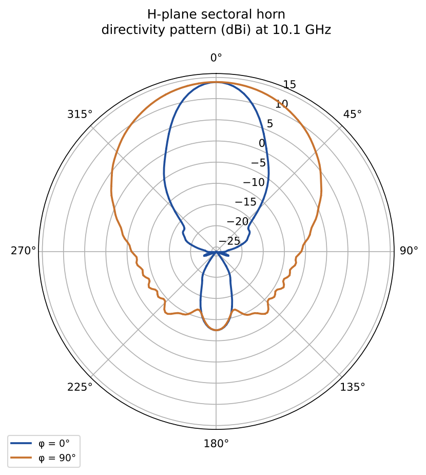
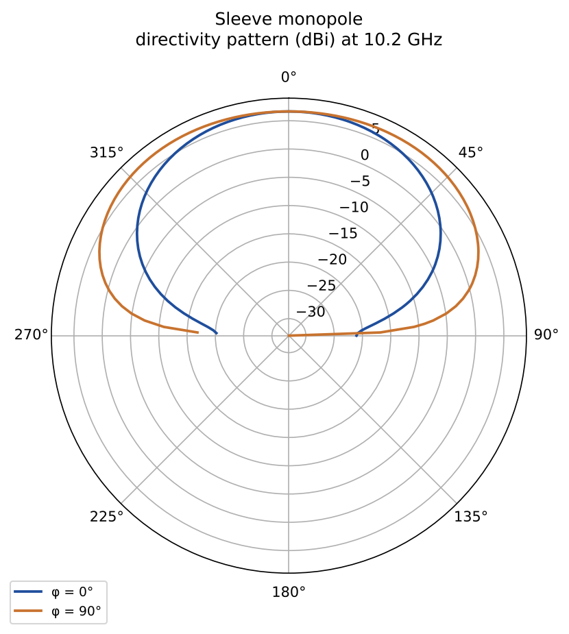
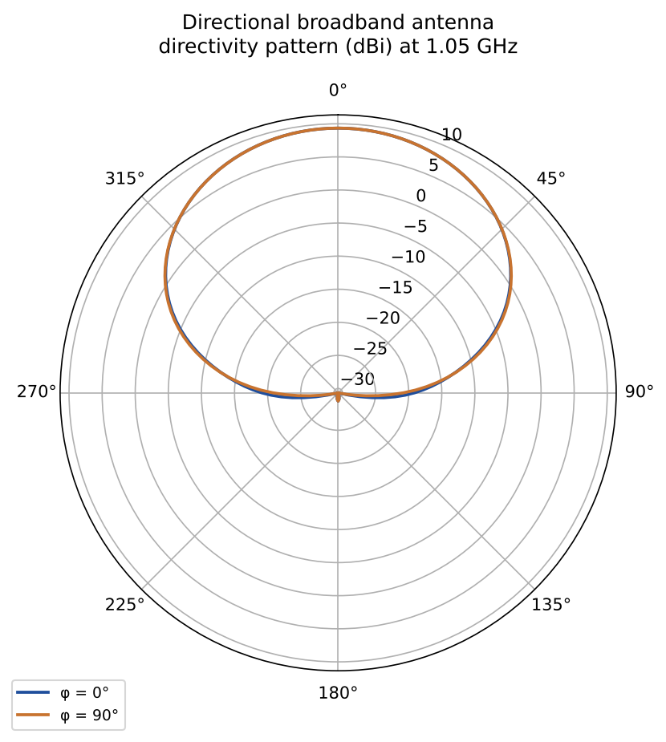
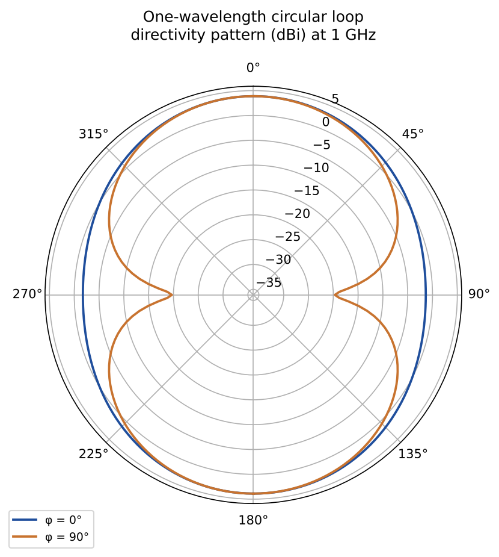
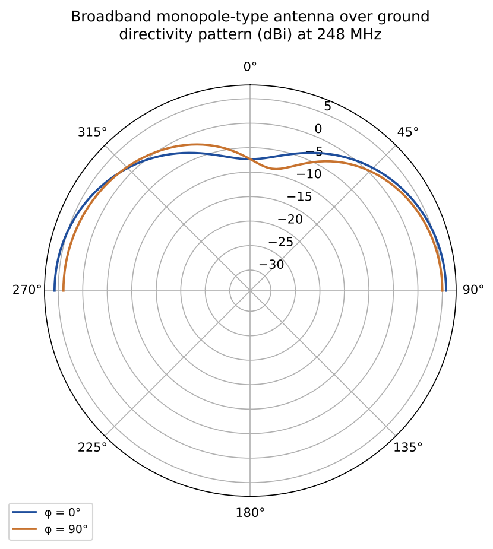

# FEKO Simulations

[← Back to Antenna Design](../README.md)

Antenna models built in Altair FEKO (method of moments). Each folder has the simulated S11 / directivity plot, the radiation pattern, and a README with its full specifications.

| Model | Type | Frequency (band) | Solver | Year |
|---|---|---|---|---|
| [E-plane sectoral horn](E-Plane-Sectoral-Horn/) | Horn antenna | 9.5–10.5 GHz (X) | MoM / MLFMM | 2017 |
| [H-plane sectoral horn](H-Plane-Sectoral-Horn/) | Horn antenna | 9.5–10.5 GHz (X) | MoM / MLFMM | 2017 |
| [Sleeve dipole over ground](Sleeve-Dipole-X-Band/) | Broadband dipole | 7.8–11.8 GHz (X) | MoM | 2016 |
| [Directional broadband antenna](Directional-Antenna-1GHz/) | Directional antenna | 0.8–1.3 GHz (UHF/L) | MoM | 2016 |
| [One-wavelength loop](One-Wavelength-Loop/) | Wire loop antenna | 1.0 GHz (UHF/L) | MoM | 2016 |
| [Broadband monopole over ground](Broadband-Monopole-VHF/) | Monopole-type antenna | 150–340 MHz (VHF/UHF) | MoM | 2016 |

## Gallery (radiation patterns)

<table>
<tr><td align="center"><a href="E-Plane-Sectoral-Horn/"></a><br><sub><a href="E-Plane-Sectoral-Horn/">E-plane sectoral horn</a></sub></td><td align="center"><a href="H-Plane-Sectoral-Horn/"></a><br><sub><a href="H-Plane-Sectoral-Horn/">H-plane sectoral horn</a></sub></td><td align="center"><a href="Sleeve-Dipole-X-Band/"></a><br><sub><a href="Sleeve-Dipole-X-Band/">Sleeve dipole over ground</a></sub></td></tr>
<tr><td align="center"><a href="Directional-Antenna-1GHz/"></a><br><sub><a href="Directional-Antenna-1GHz/">Directional broadband antenna</a></sub></td><td align="center"><a href="One-Wavelength-Loop/"></a><br><sub><a href="One-Wavelength-Loop/">One-wavelength loop</a></sub></td><td align="center"><a href="Broadband-Monopole-VHF/"></a><br><sub><a href="Broadband-Monopole-VHF/">Broadband monopole over ground</a></sub></td></tr>
</table>

## Folder structure

```
FEKO-Simulations/
├── E-Plane-Sectoral-Horn/
├── H-Plane-Sectoral-Horn/
├── Sleeve-Dipole-X-Band/
├── Directional-Antenna-1GHz/
├── One-Wavelength-Loop/
└── Broadband-Monopole-VHF/
```
