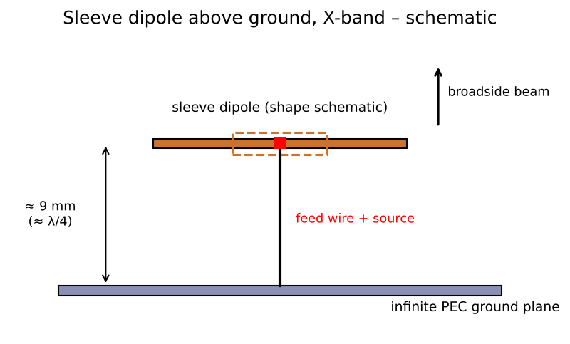
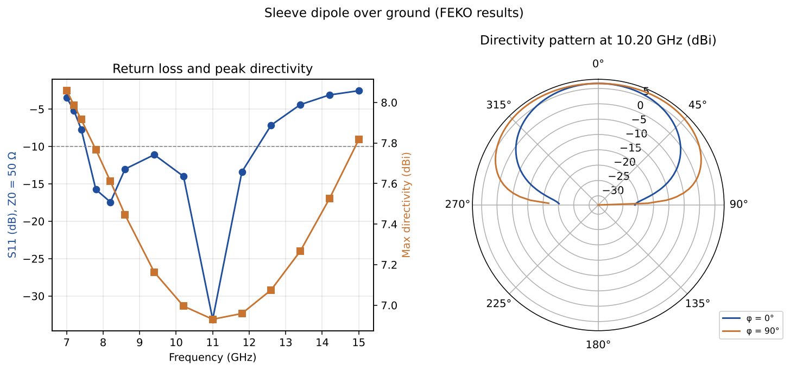

# Sleeve Dipole above Ground, X-Band (FEKO)

[← Back to FEKO Simulations](../README.md)

**Application:** A wideband, low-profile antenna radiating broadside over a ground plane, for X-band radar, wireless links, and as an array element.
The sleeve structure widens the impedance bandwidth compared with a plain dipole.

## Specifications

| Parameter | Value |
|---|---|
| Structure | Sleeve dipole about 9 mm (≈ λ/4) above an infinite PEC ground plane, fed by a vertical wire with a voltage source |
| Mesh | FEKO MoM, 1600 metallic triangles plus 7 wire segments |
| Excitation | 50 Ω voltage source at the feed node |
| Frequency range | 7–15 GHz simulated; S11 ≤ −10 dB from ≈ 7.6 to 12 GHz (X band, ≈ 45 % bandwidth) |
| Peak directivity | ≈ 7–8 dBi, broadside (normal to the ground plane) |
| Year of design | 2016 (FEKO Suite 7.0) |
