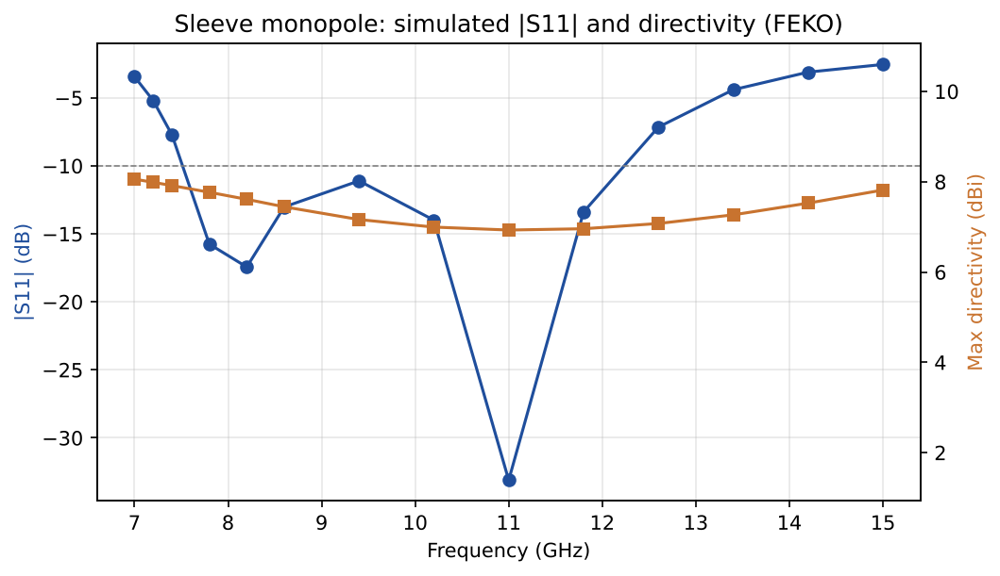

# Sleeve Dipole over a Ground Plane, X-Band (FEKO)

[← Back to FEKO Simulations](../README.md)

**Application:** A compact broadband element for X-band links, radar and sensing, and as a building block for broadband arrays.
The sleeve widens the impedance bandwidth compared with a plain dipole.

## Specifications

| Parameter | Value |
|---|---|
| Structure | Sleeve dipole about 9 mm above an infinite ground plane, fed by a vertical wire; 1,600 metallic triangles, XZ-plane symmetry |
| Excitation | Voltage source at a wire node, 50 Ω reference |
| Frequency range | 7–15 GHz sweep |
| Matching | \|S11\| < −10 dB from 7.8 to 11.8 GHz (≈ 41 % bandwidth, X band); best −33 dB at 11 GHz |
| Directivity | 6.9–8.1 dBi, maximum broadside to the ground plane |
| Year of design | 2016 (FEKO Suite 7.0) |
