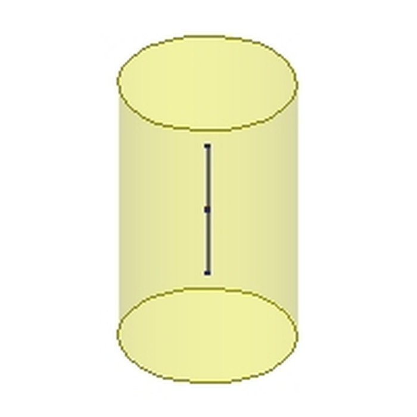
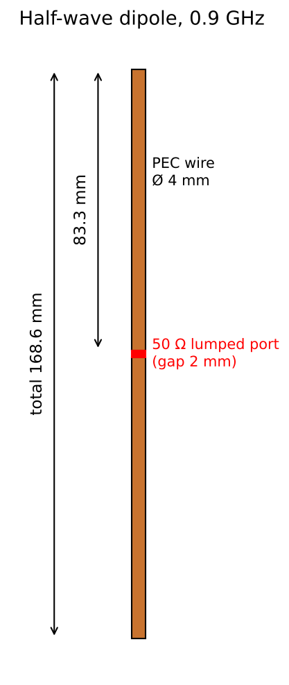

# Half-Wave Dipole Antenna (HFSS)

[← Back to HFSS Simulations](../README.md)

**Application:** The basic reference antenna for UHF links around 900 MHz, such as GSM-900, ISM 868/915 MHz, RFID and IoT radios.
It is also the textbook benchmark for impedance, VSWR and the doughnut-shaped omnidirectional pattern.

## Specifications

| Parameter | Value |
|---|---|
| Structure | Centre-fed wire dipole, two PEC arms |
| Overall dimensions | Total length 168.6 mm (2 × 83.3 mm arms + 2 mm feed gap), wire Ø 4 mm |
| Excitation | 50 Ω lumped port in the centre gap |
| Simulation domain | Air cylinder Ø 200 mm × 333 mm with radiation boundary |
| Frequency range | 0.3–1.5 GHz sweep; designed for 0.9 GHz (UHF) |
| Simulated outputs | S11, VSWR, input impedance Z11, gain pattern |
| Year of design | 2014 (HFSS 14) |
