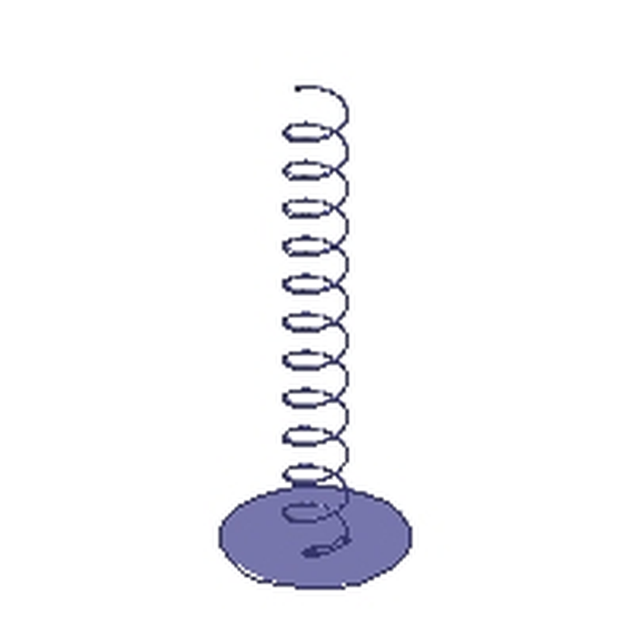
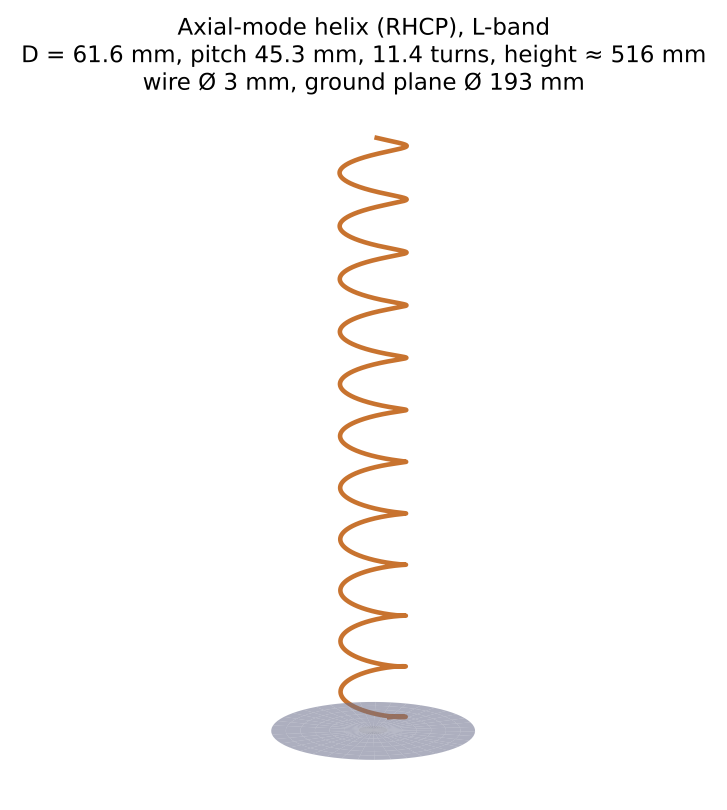

# Axial-Mode Helical Antenna, RHCP (HFSS-IE / MoM)

[← Back to HFSS Simulations](../README.md)

**Application:** A high-gain, circularly polarized (RHCP) end-fire antenna for L-band GNSS (GPS L2, Galileo E6, GLONASS L2) and satellite/telemetry links.
Circular polarization makes the link insensitive to antenna orientation and to Faraday rotation.

## Specifications

| Parameter | Value |
|---|---|
| Structure | Right-handed axial-mode helix over a circular ground plane |
| Overall dimensions | Helix Ø 61.6 mm, height ≈ 516 mm (11.4 turns, pitch 45.3 mm), wire Ø 3 mm, ground plane Ø 193 mm |
| Excitation | 50 Ω lumped port between the helix feed pin and the ground |
| Solver | HFSS-IE (integral equation / method of moments) |
| Frequency range | 1.15–1.33 GHz, L band; adaptive mesh at 1.4 GHz |
| Electrical size | Circumference ≈ 0.8 λ at 1.24 GHz (axial-mode region) |
| Simulated outputs | VSWR, total and RHCP gain, axial ratio |
| Year of design | 2014 (HFSS 14) |
