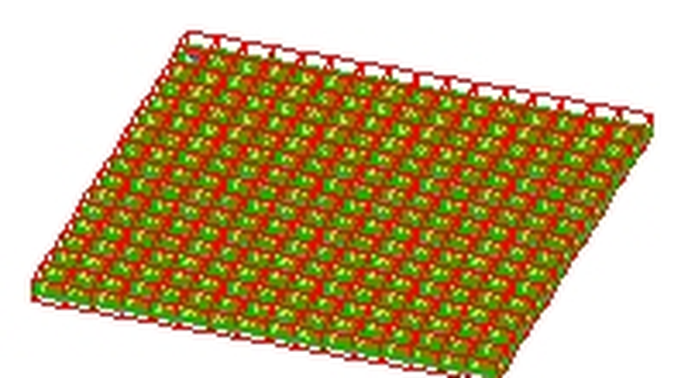
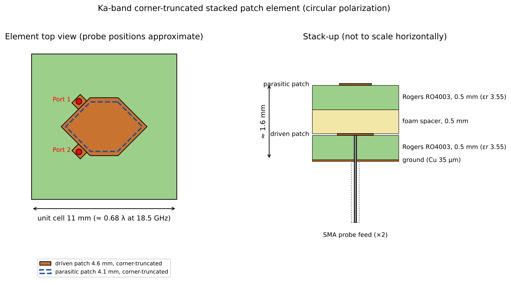

# Ka-Band Circularly Polarized Phased Array, 16×16 (HFSS)

[← Back to HFSS Simulations](../README.md)

> **Satellite communications:** designed for Ka-band satcom user terminals.

**Application:** A large flat-panel phased array for Ka-band satellite-communication terminals (satcom-on-the-move, LEO/GEO user terminals, receive at about 17.7–21.2 GHz).
Corner-truncated stacked patches give circular polarization, and progressive-phase excitation steers the beam electronically.

## Specifications

| Parameter | Value |
|---|---|
| Element | Probe-fed stacked patch with two truncated corners (driven 4.6 mm, parasitic 4.1 mm), two SMA probe ports |
| Stack-up | Rogers RO4003 0.5 mm (εr 3.55) / foam 0.5 mm / Rogers RO4003 0.5 mm; total ≈ 1.6 mm |
| Unit cell | 11 × 11 mm (≈ 0.68 λ at 18.5 GHz) |
| Array | 16 × 16 = 256 elements, finite-array (unit cell + lattice-pair) model with scan-phase excitation |
| Overall dimensions | ≈ 176 × 176 × 1.6 mm aperture |
| Frequency range | 16–21 GHz, Ka-band satellite downlink (spans upper Ku and lower K in IEEE terms); centre 18.5 GHz |
| Scan setting | Broadside (θ = 0°), parametric scan variables included |
| Design variants in the project | Single element (two orientations, the second rotated 45°), 16 × 16 array |
| Year of design | 2021 (ANSYS Electronics Desktop 2020 R2) |
