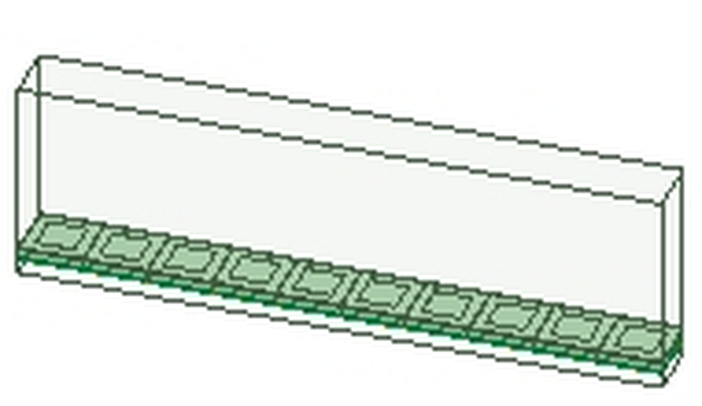
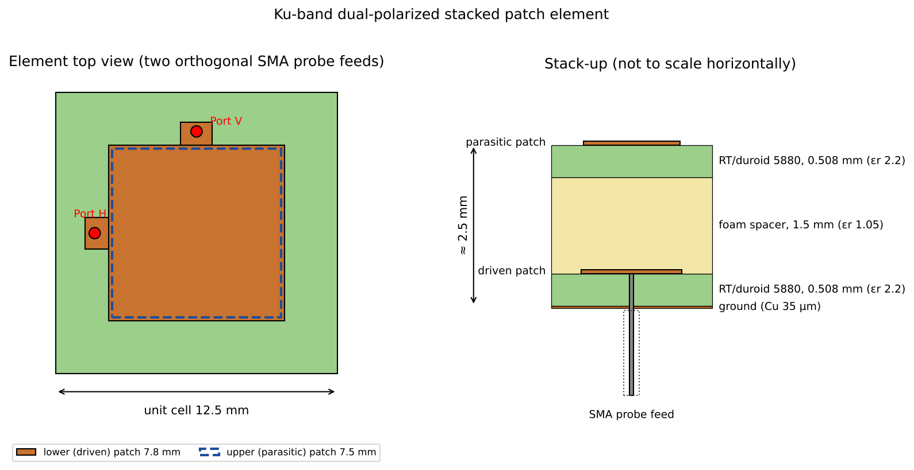

# Ku-Band Dual-Polarized Stacked Patch Array, 1×10 (HFSS)

[← Back to HFSS Simulations](../README.md)

**Application:** A low-profile dual-polarized (V/H) phased-array antenna for Ku-band satellite communication (VSAT, satellite TV, satcom-on-the-move) and radar.
A progressive phase on the element ports steers the beam electronically along the array axis.

## Specifications

| Parameter | Value |
|---|---|
| Element | Probe-fed stacked patch: driven patch 7.8 × 7.8 mm, parasitic patch 7.5 × 7.5 mm, two orthogonal SMA probe feeds (V and H ports) |
| Stack-up | RT/duroid 5880 0.508 mm (εr 2.2) / foam 1.5 mm (εr 1.05) / RT/duroid 5880 0.508 mm; total ≈ 2.5 mm |
| Unit cell | 12.5 × 12.5 mm (≈ 0.5 λ at 12 GHz) |
| Array | 1 × 10 linear array, 20 lumped ports (V1–V10, H1–H10), progressive-phase excitation for beam steering |
| Overall dimensions | Array aperture ≈ 125 × 12.5 × 2.5 mm |
| Frequency range | 11–14 GHz, Ku band; adaptive mesh at 12 GHz |
| Simulated outputs | S-parameters (return loss, V/H port isolation), co- and cross-polar gain patterns |
| Design variants in the project | Element (stacked, foam 1.5 mm), element variant (foam 0.7 mm, 8 mm patch), single-layer patch on RO4350 (11.2–11.8 GHz), 1 × 10 array |
| Year of design | 2021 (ANSYS Electronics Desktop 2020 R2) |
