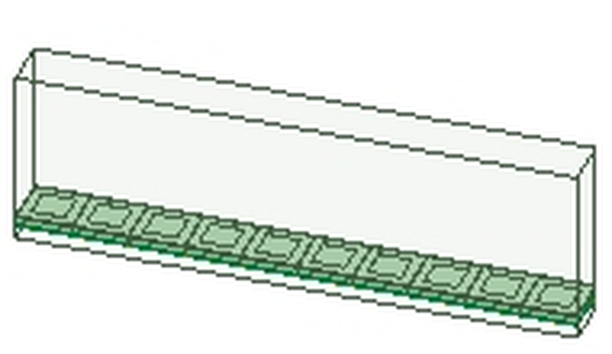
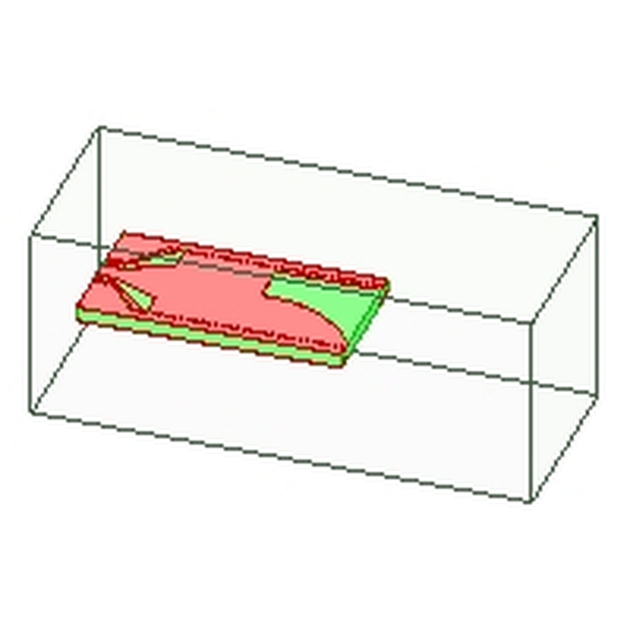
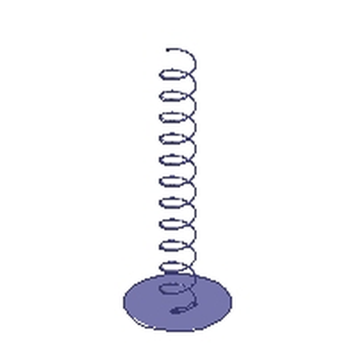
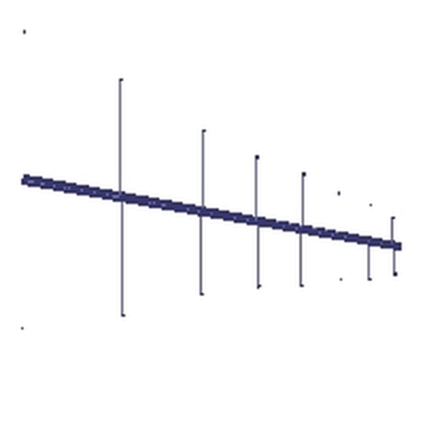
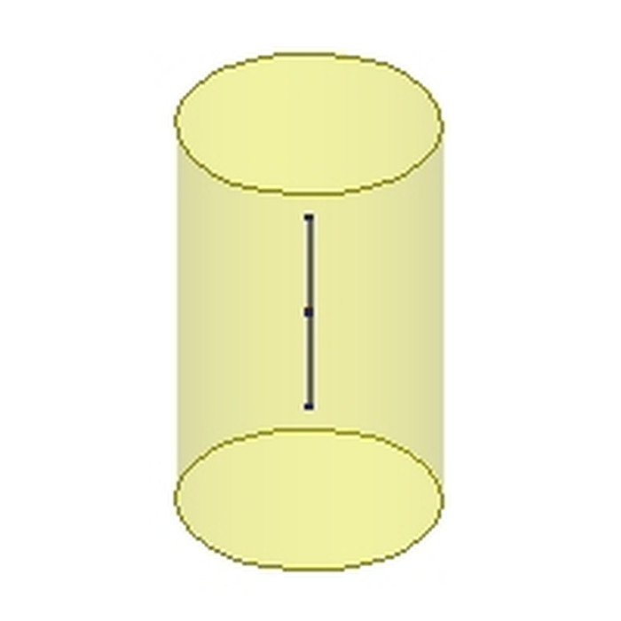
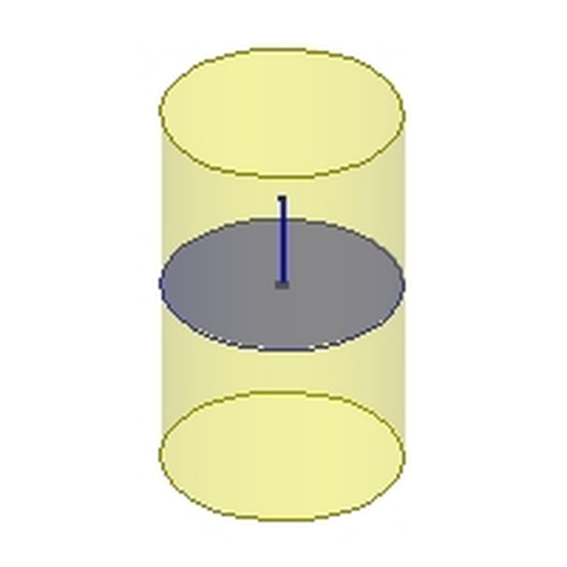
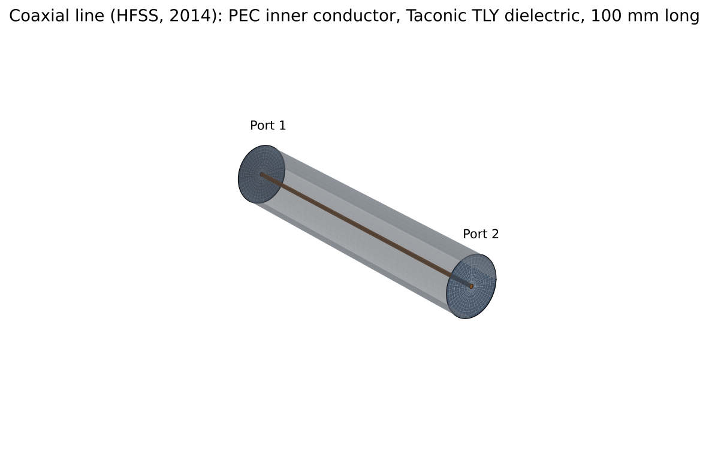
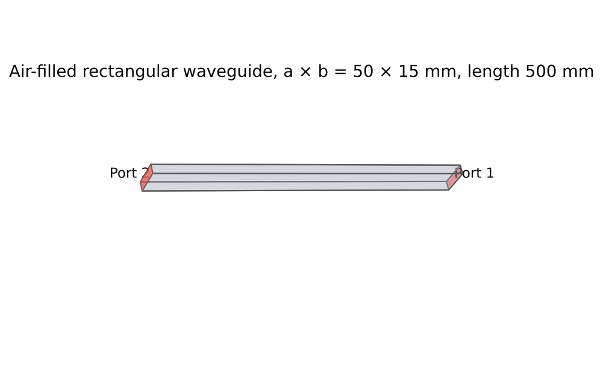

# HFSS Simulations

[← Back to Antenna Design](../README.md)

Antenna and transmission-line models built in ANSYS HFSS / Electronics Desktop.
Each folder has images of the model and a README with its full specifications.

| Model | Type | Frequency (band) | Solver | Year |
|---|---|---|---|---|
| [Ku-band dual-pol stacked patch array (1×10)](Ku-Band-Dual-Pol-Patch-Array/) | Stacked patch phased array | 11–14 GHz (Ku) | HFSS (FEM) | 2021 |
| [SIW-fed end-fire antenna](SIW-Antenna/) | Planar SIW antenna | 7–13 GHz (X) | HFSS (FEM) | 2018 |
| [Axial-mode helix (RHCP)](Helix-Antenna/) | CP antenna | 1.15–1.33 GHz (L) | HFSS-IE (MoM) | 2014 |
| [Log-periodic dipole array](Log-Periodic-Dipole-Array/) | Wideband array | 54–216 MHz (VHF) | HFSS-IE (MoM) | 2015 |
| [Half-wave dipole](Half-Wave-Dipole/) | Wire antenna | 0.9 GHz (UHF) | HFSS (FEM) | 2014 |
| [Quarter-wave monopole](Quarter-Wave-Monopole/) | Wire antenna | 0.9 GHz (UHF) | HFSS (FEM) | 2014 |
| [Coaxial line](Coaxial-Line/) | Transmission line | 1–5 GHz (L/S/C) | HFSS (FEM) | 2014 |
| [Rectangular waveguide](Rectangular-Waveguide/) | Transmission line | 2–10 GHz (S/C/X) | HFSS (FEM) | 2014 |

## Gallery

<table>
<tr><td align="center"><a href="Ku-Band-Dual-Pol-Patch-Array/"></a><br><sub><a href="Ku-Band-Dual-Pol-Patch-Array/">Ku-band dual-pol patch array</a></sub></td><td align="center"><a href="SIW-Antenna/"></a><br><sub><a href="SIW-Antenna/">SIW-fed end-fire antenna</a></sub></td><td align="center"><a href="Helix-Antenna/"></a><br><sub><a href="Helix-Antenna/">Axial-mode helix (RHCP)</a></sub></td><td align="center"><a href="Log-Periodic-Dipole-Array/"></a><br><sub><a href="Log-Periodic-Dipole-Array/">Log-periodic dipole array</a></sub></td></tr>
<tr><td align="center"><a href="Half-Wave-Dipole/"></a><br><sub><a href="Half-Wave-Dipole/">Half-wave dipole</a></sub></td><td align="center"><a href="Quarter-Wave-Monopole/"></a><br><sub><a href="Quarter-Wave-Monopole/">Quarter-wave monopole</a></sub></td><td align="center"><a href="Coaxial-Line/"></a><br><sub><a href="Coaxial-Line/">Coaxial line</a></sub></td><td align="center"><a href="Rectangular-Waveguide/"></a><br><sub><a href="Rectangular-Waveguide/">Rectangular waveguide</a></sub></td></tr>
</table>

## Folder structure

```
HFSS-Simulations/
├── Ku-Band-Dual-Pol-Patch-Array/
├── SIW-Antenna/
├── Helix-Antenna/
├── Log-Periodic-Dipole-Array/
├── Half-Wave-Dipole/
├── Quarter-Wave-Monopole/
├── Coaxial-Line/
└── Rectangular-Waveguide/
```
