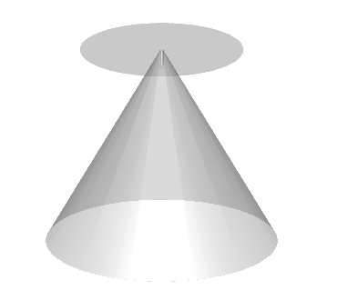
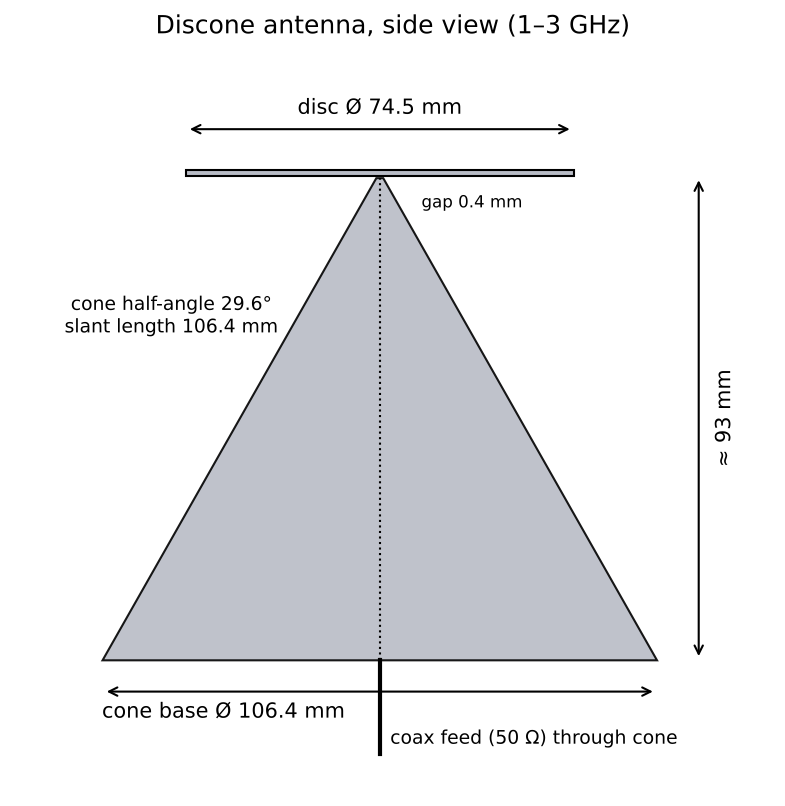

# CST Simulations

[← Back to Antenna](../README.md)

Antenna models built in CST Microwave Studio. Each folder has images of the model, a README with its full specifications, and the original CST project file (`.cst`) so you can download it and re-run the simulation.

| Model | Type | Frequency (band) | Solver | Year |
|---|---|---|---|---|
| [Discone](Discone/) | Wideband omnidirectional antenna | 1–3 GHz (L/S) | CST MWS time domain | 2016 |

## Gallery

<table>
<tr><td align="center"> <a href="Discone/">Discone (CST model)</a></td><td align="center"> <a href="Discone/">Discone (side view, dimensions)</a></td></tr>
</table>
