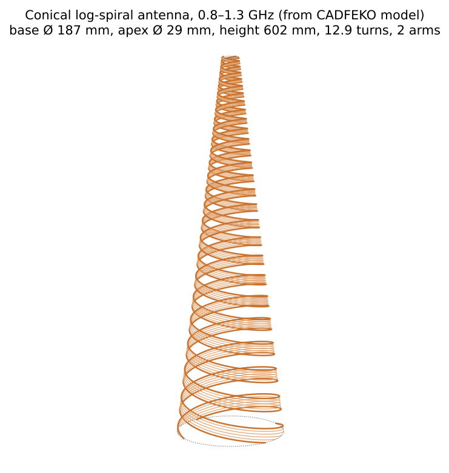
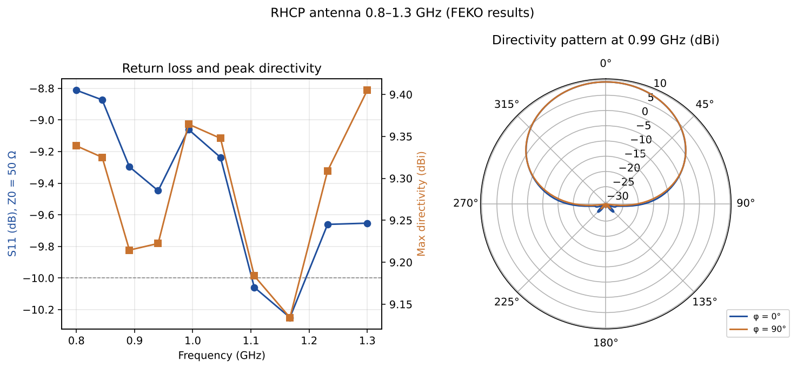

# Conical Spiral Antenna, L-Band (FEKO)

[← Back to FEKO Simulations](../README.md)

**Application:** A frequency-independent, circularly polarized antenna (Dyson conical spiral) for L-band satellite links, GNSS, telemetry and wideband direction finding.
It gives a broad unidirectional beam off the small end of the cone, with an almost constant pattern and impedance across the band.

## Specifications

| Parameter | Value |
|---|---|
| Structure | Two-arm equiangular (log) spiral wound on a cone, fed at the apex |
| Overall dimensions | Base Ø 187.4 mm, truncated apex Ø 28.8 mm, height 602 mm |
| Spiral | 12.9 turns, angular arm width 160° |
| Excitation | 50 Ω edge voltage source at the apex; input impedance ≈ 90–100 Ω |
| Solver | FEKO 7.0 method of moments, 2588 triangles |
| Frequency range | 0.8–1.3 GHz (upper UHF / L band) |
| Peak directivity | 9.1–9.4 dBi, nearly constant over the band |
| Polarization | Right-hand circular, axial ratio ≈ 0.2 dB at boresight, front-to-back ≈ 38 dB |
| Half-power beamwidth | ≈ 68–72° |
| Year of design | 2016 (FEKO Suite 7.0) |

## Source file (download to simulate)

| File | Description |
|---|---|
| [`conical_log_spiral.cfx`](conical_log_spiral.cfx) | CADFEKO model (FEKO 7.0) |

Open with Altair FEKO (CADFEKO 7.0 or newer); open the .cfx and run the solver to regenerate results. ANSYS HFSS cannot open this format directly; export the geometry as STEP from the original tool to reuse it in HFSS.
