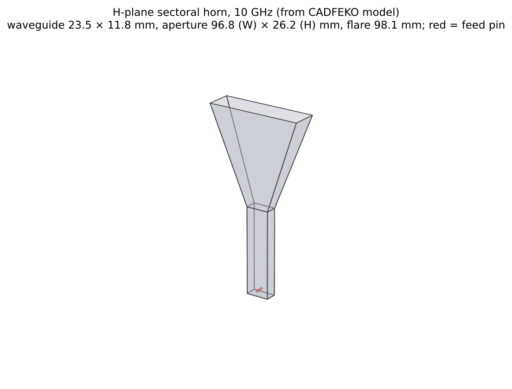
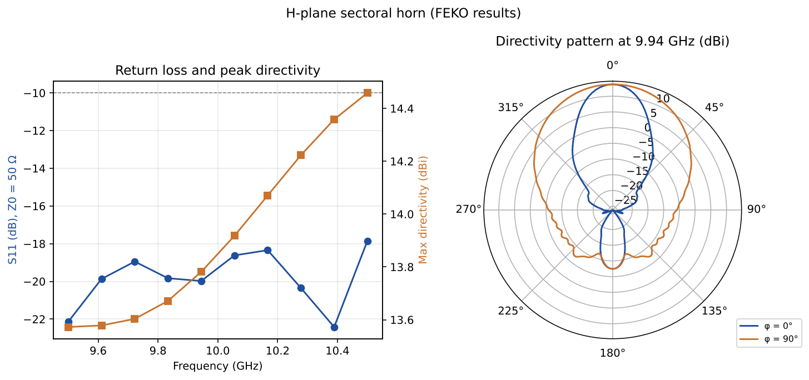

# H-Plane Sectoral Horn, X-Band (FEKO)

[← Back to FEKO Simulations](../README.md)

**Application:** A medium-gain directional antenna for X-band radar, test and measurement, and as a feed for reflector antennas.
Flaring only the H-plane gives a fan-shaped beam: narrow in the H-plane and wide in the other plane.

## Specifications

| Parameter | Value |
|---|---|
| Overall dimensions | Aperture 96.8 mm wide × 26.2 mm high; flare length 98.1 mm; feed waveguide 23.5 × 11.8 mm, 89.9 mm long |
| Structure | Rectangular waveguide flared in the H-plane only, fed by a coaxial pin 6.8 mm long (Ø 0.3 mm), 5.6 mm from the back wall |
| Mesh | FEKO MoM, 18338 metallic triangles plus a short wire feed pin |
| Excitation | 50 Ω voltage source on the feed pin |
| Frequency range | 9.5–10.5 GHz (X band) |
| Return loss | S11 ≤ −17.8 dB over the whole band |
| Peak directivity | 13.6–14.5 dBi |
| Half-power beamwidth | ≈ 20° (H-plane) / ≈ 56–60° (E-plane) |
| Year of design | 2017 (FEKO Suite 7.0.2) |

## Source file (download to simulate)

| File | Description |
|---|---|
| [`Hplane_horn.cfx`](Hplane_horn.cfx) | CADFEKO model (FEKO 7.0.2) |

Open with Altair FEKO (CADFEKO 7.0 or newer); open the .cfx and run the solver to regenerate results. ANSYS HFSS cannot open this format directly; export the geometry as STEP from the original tool to reuse it in HFSS.
