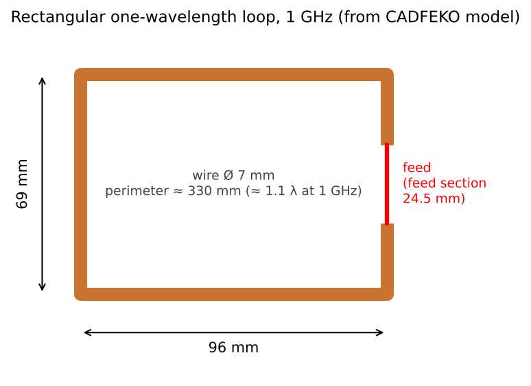
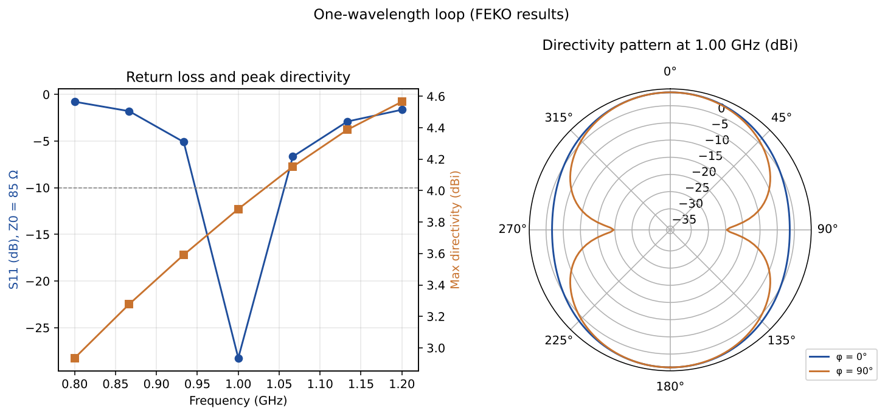

# One-Wavelength Rectangular Loop Antenna (FEKO)

[← Back to FEKO Simulations](../README.md)

**Application:** A simple resonant loop antenna around 1 GHz, used as an element in loop arrays (quad and Yagi-type) and as a teaching reference for resonant loops.
It radiates broadside to the loop plane, with about 3–4 dBi gain.

## Specifications

| Parameter | Value |
|---|---|
| Structure | Rectangular wire loop in the x–y plane, fed at the middle of one short side |
| Overall dimensions | 96 mm × 69 mm, wire Ø 7 mm (perimeter ≈ 330 mm ≈ 1.1 λ at 1 GHz, corrected for the thick wire) |
| Excitation | Voltage source at one point on the loop; S-parameters referenced to 50 Ω and 85 Ω |
| Resonance | 1.0 GHz, input impedance ≈ 86 − j6 Ω (S11 = −28 dB for 85 Ω, −11 dB for 50 Ω) |
| Frequency range | 0.8–1.2 GHz (UHF / L band) |
| Peak directivity | 2.9–4.6 dBi (3.9 dBi at resonance), maximum normal to the loop |
| Year of design | 2016 (FEKO Suite 7.0) |

## Source file (download to simulate)

| File | Description |
|---|---|
| [`rectangular_loop.cfx`](rectangular_loop.cfx) | CADFEKO model (FEKO 7.0) |

Open with Altair FEKO (CADFEKO 7.0 or newer); open the .cfx and run the solver to regenerate results. ANSYS HFSS cannot open this format directly; export the geometry as STEP from the original tool to reuse it in HFSS.
