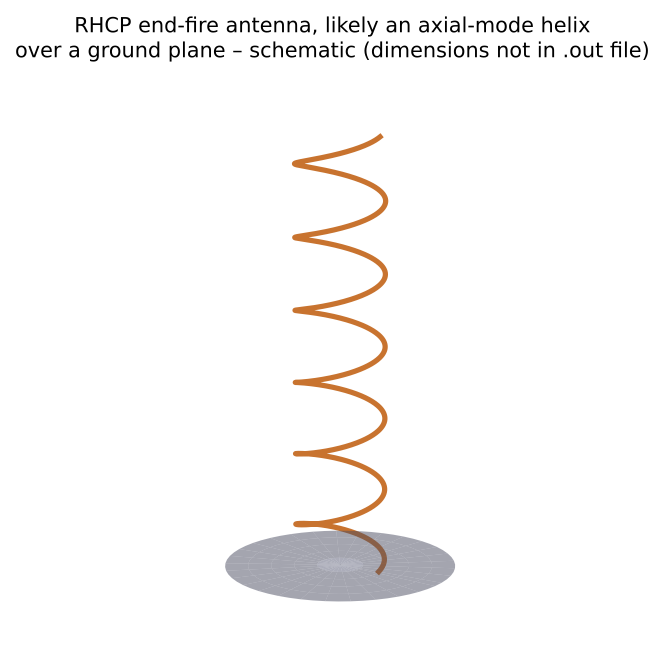
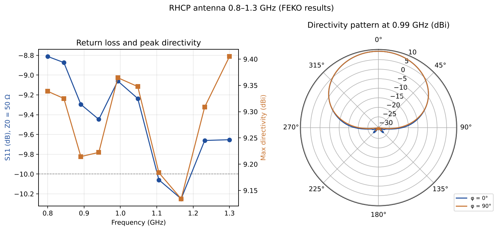

# Conical Spiral Antenna, 0.8–1.3 GHz (FEKO)

[← Back to FEKO Simulations](../README.md)

**Application:** A circularly polarized, high-gain end-fire antenna for L-band satellite links, GNSS and telemetry, where orientation-independent reception is needed.
The simulated performance (RHCP, axial ratio ≈ 0.2 dB, ~9.3 dBi) matches an axial-mode helix over a ground plane.

## Specifications

| Parameter | Value |
|---|---|
| Structure | Likely an axial-mode helix over a ground plane (geometry not stored in the solver output) |
| Mesh | FEKO MoM, 2588 metallic triangles, total metal area 0.18 m² |
| Excitation | 50 Ω edge voltage source; input impedance ≈ 90–100 Ω |
| Frequency range | 0.8–1.3 GHz (upper UHF / L band) |
| Peak directivity | 9.1–9.4 dBi, nearly constant over the band |
| Polarization | Right-hand circular, axial ratio ≈ 1.02 (0.2 dB) at boresight, front-to-back ≈ 38 dB |
| Half-power beamwidth | ≈ 68–72° |
| Year of design | 2016 (FEKO Suite 7.0) |
