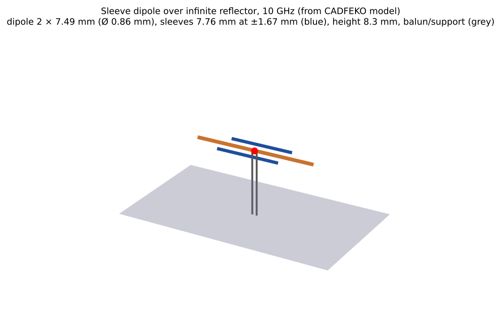
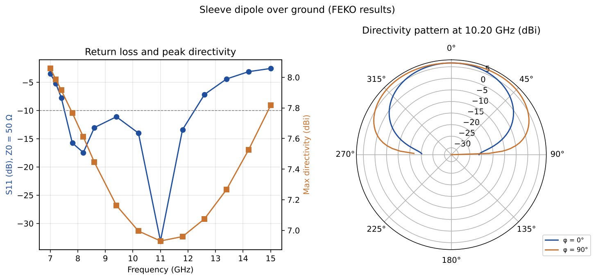

# Sleeve Dipole above Ground, X-Band (FEKO)

[← Back to FEKO Simulations](../README.md)

**Application:** A wideband, low-profile antenna radiating broadside over a ground plane, for X-band radar, wireless links, and as an array element.
The sleeve structure widens the impedance bandwidth compared with a plain dipole.

## Specifications

| Parameter | Value |
|---|---|
| Structure | Cylindrical dipole with two parallel parasitic sleeve elements and a balun/support, above an infinite PEC reflector |
| Overall dimensions | Dipole 2 × 7.49 mm arms (≈ 15 mm total), Ø 0.86 mm; sleeves 7.76 mm long at ±1.67 mm; height above reflector 8.3 mm |
| Mesh | FEKO MoM, 1600 metallic triangles plus 7 wire segments |
| Excitation | 50 Ω voltage source at the feed node |
| Frequency range | 7–15 GHz simulated; S11 ≤ −10 dB from ≈ 7.6 to 12 GHz (X band, ≈ 45 % bandwidth) |
| Peak directivity | ≈ 7–8 dBi, broadside (normal to the ground plane) |
| Year of design | 2016 (FEKO Suite 7.0) |

## Source file (download to simulate)

| File | Description |
|---|---|
| [`sleeve_dipole.cfx`](sleeve_dipole.cfx) | CADFEKO model (FEKO 7.0) |

Open with Altair FEKO (CADFEKO 7.0 or newer); open the .cfx and run the solver to regenerate results. ANSYS HFSS cannot open this format directly; export the geometry as STEP from the original tool to reuse it in HFSS.
