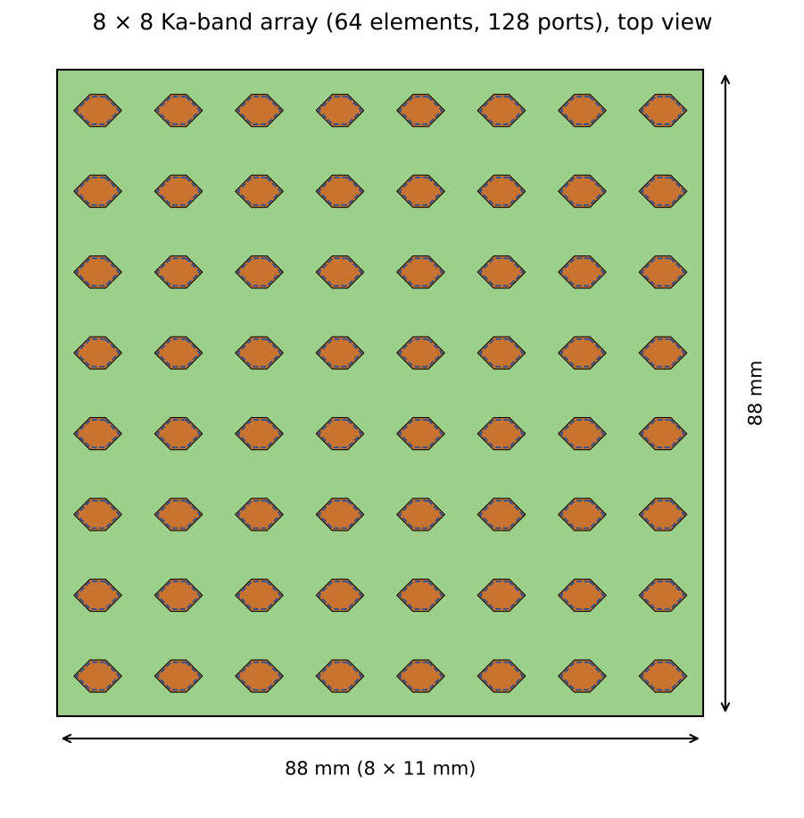
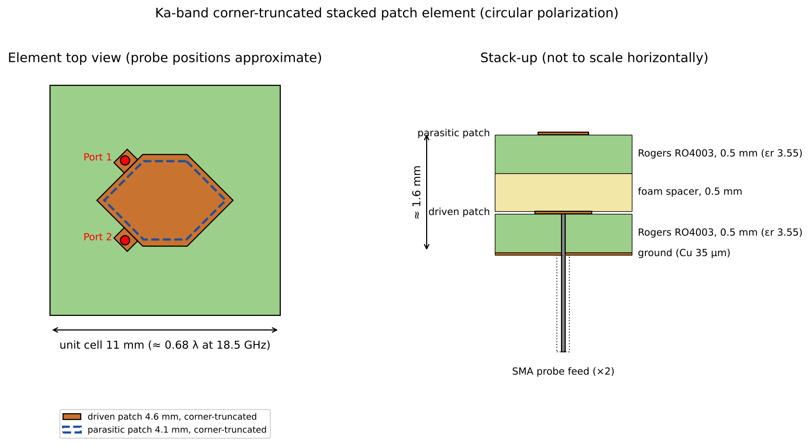

# Ka-Band Circularly Polarized Phased Array, 8×8 (HFSS)

[← Back to HFSS Simulations](../README.md)

> **Satellite communications:** designed for Ka-band satcom user terminals.

**Application:** A compact 64-element phased-array tile for Ka-band satellite user terminals and beam-steering studies (receive at about 17.7–21.2 GHz).
The model is set up to check performance at wide scan angles (up to θ = 60°).

## Specifications

| Parameter | Value |
|---|---|
| Element | Probe-fed stacked patch with two truncated corners (driven 4.6 mm, parasitic 4.1 mm), two SMA probe ports |
| Stack-up | Rogers RO4003 0.5 mm (εr 3.55) / foam 0.5 mm / Rogers RO4003 0.5 mm; total ≈ 1.6 mm |
| Unit cell | 11 × 11 mm (≈ 0.68 λ at 18.5 GHz) |
| Array | 8 × 8 = 64 elements, finite-array (unit cell + lattice-pair) model with scan-phase excitation |
| Overall dimensions | ≈ 88 × 88 × 1.6 mm aperture |
| Frequency range | 16–21 GHz, Ka-band satellite downlink (spans upper Ku and lower K in IEEE terms); centre 18.5 GHz |
| Scan setting | θ = 60°, φ = 90° |
| Year of design | 2021 (ANSYS Electronics Desktop 2020 R2) |

## Source file (download to simulate)

| File | Description |
|---|---|
| [`Array_64_elements.aedt`](Array_64_elements.aedt) | ANSYS Electronics Desktop project (ACIS geometry) |

Open it with ANSYS HFSS / Electronics Desktop. The geometry uses the ACIS kernel, so AEDT 2025 R1 and later cannot open it directly: open and save it once in AEDT 2024 R2 (or earlier) to convert it to Parasolid. Simulation results are not included; re-run the analysis setup to regenerate them.
