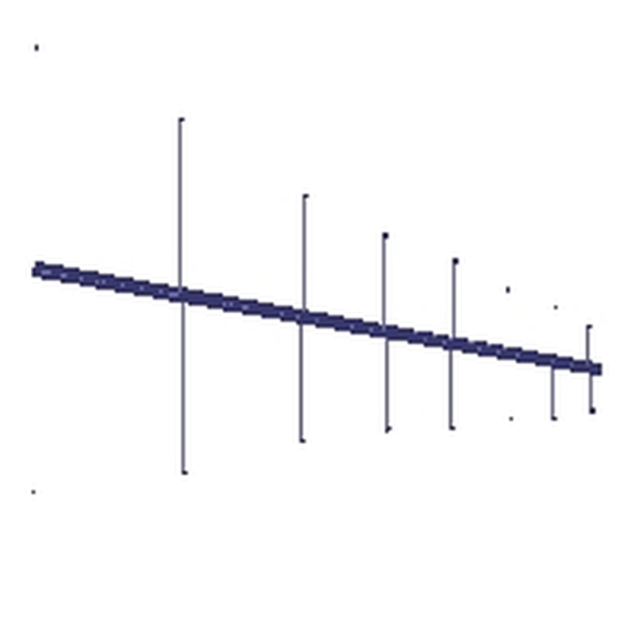
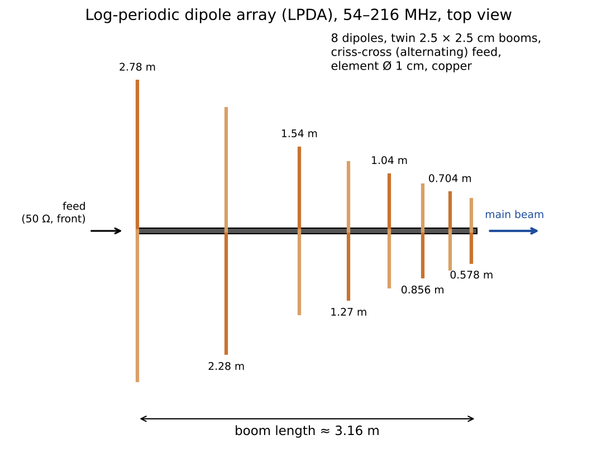

# Log-Periodic Dipole Array, VHF (HFSS-IE / MoM)

[← Back to HFSS Simulations](../README.md)

**Application:** A wideband directional antenna for VHF television (bands I and III) and FM broadcast reception, and for wideband EMC testing.
Gain and impedance stay nearly constant over a 4:1 bandwidth.

## Specifications

| Parameter | Value |
|---|---|
| Structure | 8 copper dipoles on twin square booms, criss-cross (alternating) feed |
| Overall dimensions | Boom length ≈ 3.16 m, longest element 2.78 m, shortest 0.578 m, element Ø 1 cm, booms 2.5 × 2.5 cm |
| Element spacings | 0.827, 0.679, 0.459, 0.378, 0.31, 0.255, 0.20 m |
| Excitation | 50 Ω lumped port at the front (short-element end) |
| Solver | HFSS-IE (integral equation / method of moments) |
| Frequency range | 54–216 MHz, VHF; adaptive mesh at 130 MHz |
| Simulated outputs | VSWR, total gain |
| Year of design | 2015 (ANSYS Electronics Desktop 2016 R2) |

## Source file (download to simulate)

| File | Description |
|---|---|
| [`lpda.aedt`](lpda.aedt) | ANSYS Electronics Desktop project (ACIS geometry) |

Open it with ANSYS HFSS / Electronics Desktop. The geometry uses the ACIS kernel, so AEDT 2025 R1 and later cannot open it directly: open and save it once in AEDT 2024 R2 (or earlier) to convert it to Parasolid. Simulation results are not included; re-run the analysis setup to regenerate them.
