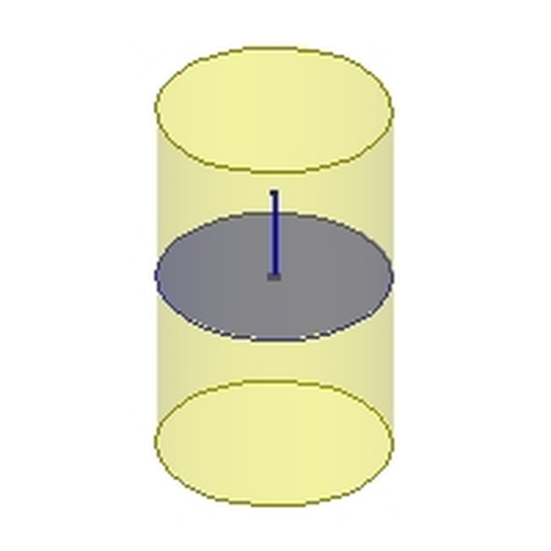
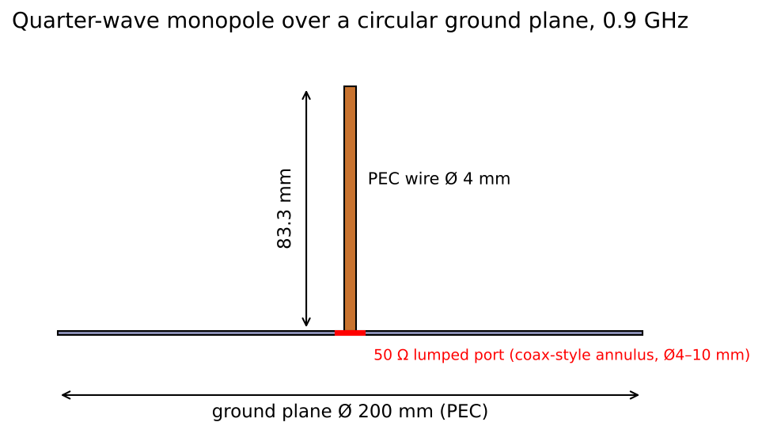

# Quarter-Wave Monopole over a Ground Plane (HFSS)

[← Back to HFSS Simulations](../README.md)

**Application:** An omnidirectional vertical antenna for UHF systems around 900 MHz, such as vehicle, base-station and IoT terminals.
It is half the size of a dipole thanks to the ground-plane image, and is widely used as a reference design.

## Specifications

| Parameter | Value |
|---|---|
| Structure | Vertical PEC wire over a circular PEC ground plane |
| Overall dimensions | Monopole height 83.3 mm, wire Ø 4 mm, ground plane Ø 200 mm |
| Excitation | 50 Ω lumped port (coax-style annulus at the base) |
| Simulation domain | Air cylinder Ø 200 mm × 333 mm with radiation boundary |
| Frequency range | 0.3–1.5 GHz sweep; designed for 0.9 GHz (UHF) |
| Simulated outputs | S11, VSWR, input impedance Z11, gain pattern |
| Year of design | 2014 (HFSS 14) |

## Source file (download to simulate)

| File | Description |
|---|---|
| [`monopole.hfss`](monopole.hfss) | legacy HFSS project (HFSS 14/15, ACIS geometry) |

Open it with ANSYS HFSS / Electronics Desktop. The geometry uses the ACIS kernel, so AEDT 2025 R1 and later cannot open it directly: open and save it once in AEDT 2024 R2 (or earlier) to convert it to Parasolid. Simulation results are not included; re-run the analysis setup to regenerate them.
