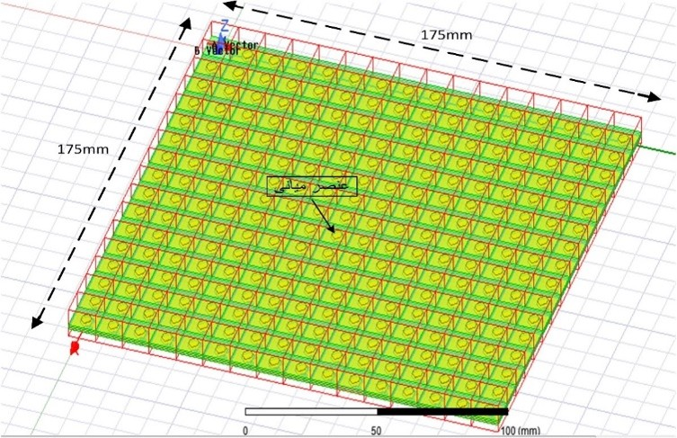
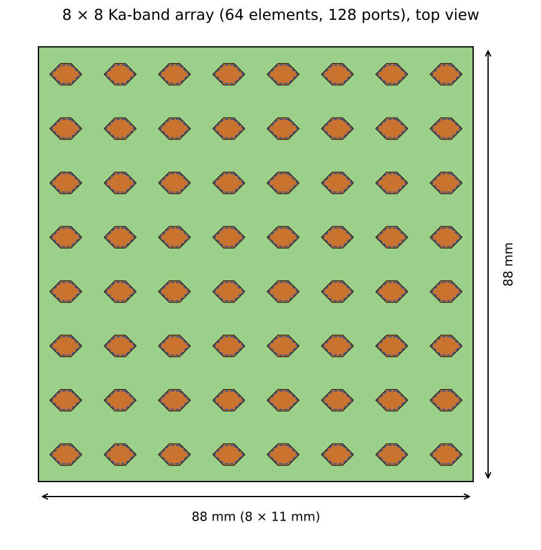
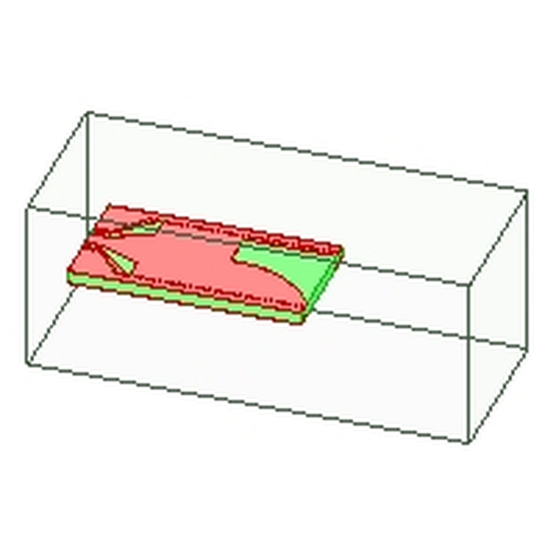
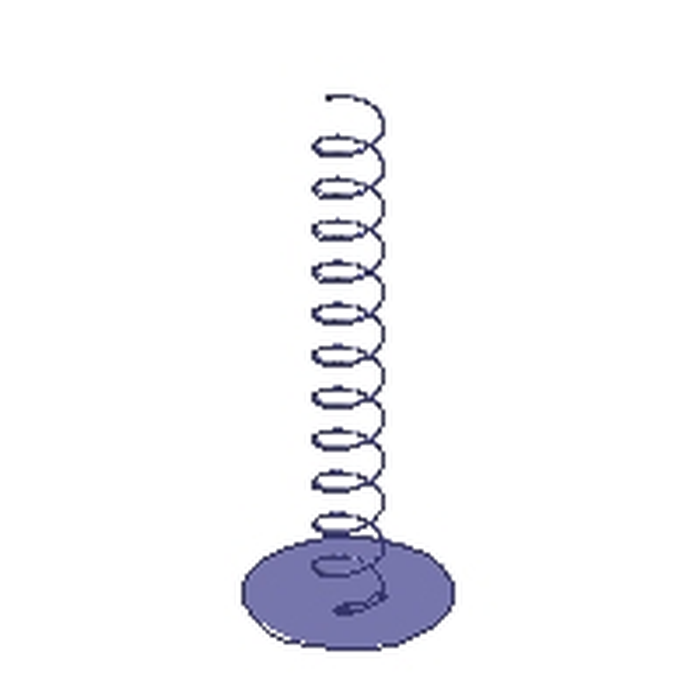
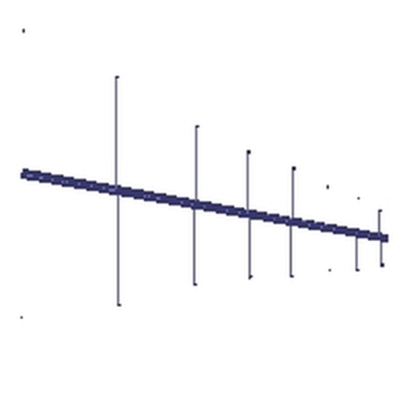
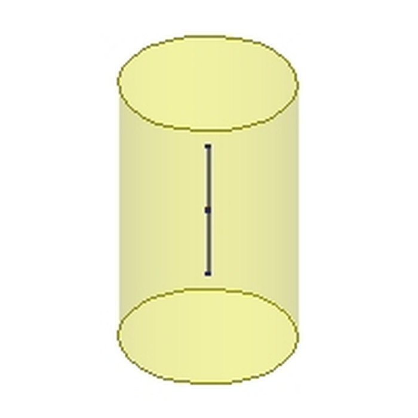
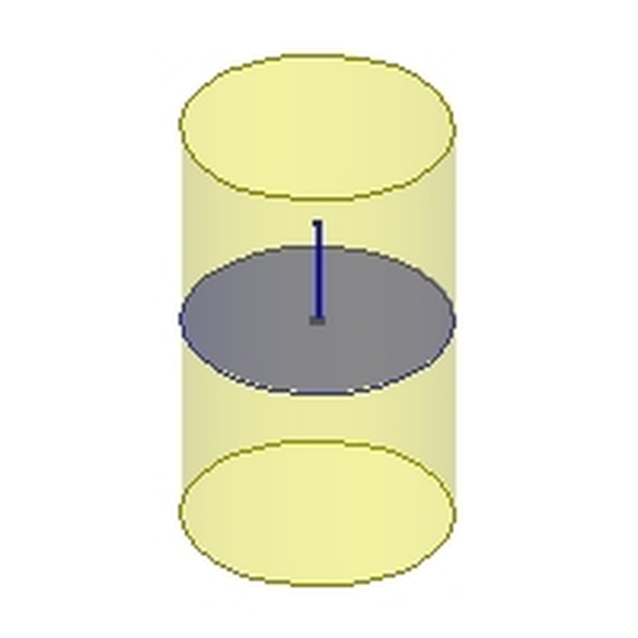

# HFSS Simulations

[← Back to Antenna](../README.md)

Antenna models built in ANSYS HFSS / Electronics Desktop, including two Ka-band phased arrays for satellite communications.
Each folder has images of the model, a README with its full specifications, and the original HFSS project file (`.hfss` or `.aedt`) so you can download it and re-run the simulation.

| Model | Type | Frequency (band) | Solver | Year |
|---|---|---|---|---|
| [Ka-band CP phased array 16×16](Ka-Band-CP-Array-16x16/) | 256-element stacked-patch array for satellite communications | 16–21 GHz (Ka satcom) | HFSS (FEM) | 2021 |
| [Ka-band CP phased array 8×8](Ka-Band-CP-Array-8x8/) | 64-element stacked-patch array for satellite communications | 16–21 GHz (Ka satcom) | HFSS (FEM) | 2021 |
| [SIW-fed end-fire antenna](SIW-Antenna/) | Planar SIW antenna | 7–13 GHz (X) | HFSS (FEM) | 2018 |
| [Axial-mode helix (RHCP)](Helix-Antenna/) | CP antenna | 1.15–1.33 GHz (L) | HFSS-IE (MoM) | 2014 |
| [Log-periodic dipole array](Log-Periodic-Dipole-Array/) | Wideband array | 54–216 MHz (VHF) | HFSS-IE (MoM) | 2015 |
| [Half-wave dipole](Half-Wave-Dipole/) | Wire antenna | 0.9 GHz (UHF) | HFSS (FEM) | 2014 |
| [Quarter-wave monopole](Quarter-Wave-Monopole/) | Wire antenna | 0.9 GHz (UHF) | HFSS (FEM) | 2014 |

## Gallery

<table>
<tr><td align="center"><a href="Ka-Band-CP-Array-16x16/"></a><br><sub><a href="Ka-Band-CP-Array-16x16/">Ka-band CP array 16×16 (satcom)</a></sub></td><td align="center"><a href="Ka-Band-CP-Array-8x8/"></a><br><sub><a href="Ka-Band-CP-Array-8x8/">Ka-band CP array 8×8 (satcom)</a></sub></td><td align="center"><a href="SIW-Antenna/"></a><br><sub><a href="SIW-Antenna/">SIW-fed end-fire antenna</a></sub></td><td align="center"><a href="Helix-Antenna/"></a><br><sub><a href="Helix-Antenna/">Axial-mode helix (RHCP)</a></sub></td></tr>
<tr><td align="center"><a href="Log-Periodic-Dipole-Array/"></a><br><sub><a href="Log-Periodic-Dipole-Array/">Log-periodic dipole array</a></sub></td><td align="center"><a href="Half-Wave-Dipole/"></a><br><sub><a href="Half-Wave-Dipole/">Half-wave dipole</a></sub></td><td align="center"><a href="Quarter-Wave-Monopole/"></a><br><sub><a href="Quarter-Wave-Monopole/">Quarter-wave monopole</a></sub></td></tr>
</table>

## Folder structure

```
HFSS-Simulations/
├── Ka-Band-CP-Array-16x16/
├── Ka-Band-CP-Array-8x8/
├── SIW-Antenna/
├── Helix-Antenna/
├── Log-Periodic-Dipole-Array/
├── Half-Wave-Dipole/
└── Quarter-Wave-Monopole/
```

Transmission-line models (coaxial line, rectangular waveguide) are in [Transmission-Line](../../Transmission-Line/).
