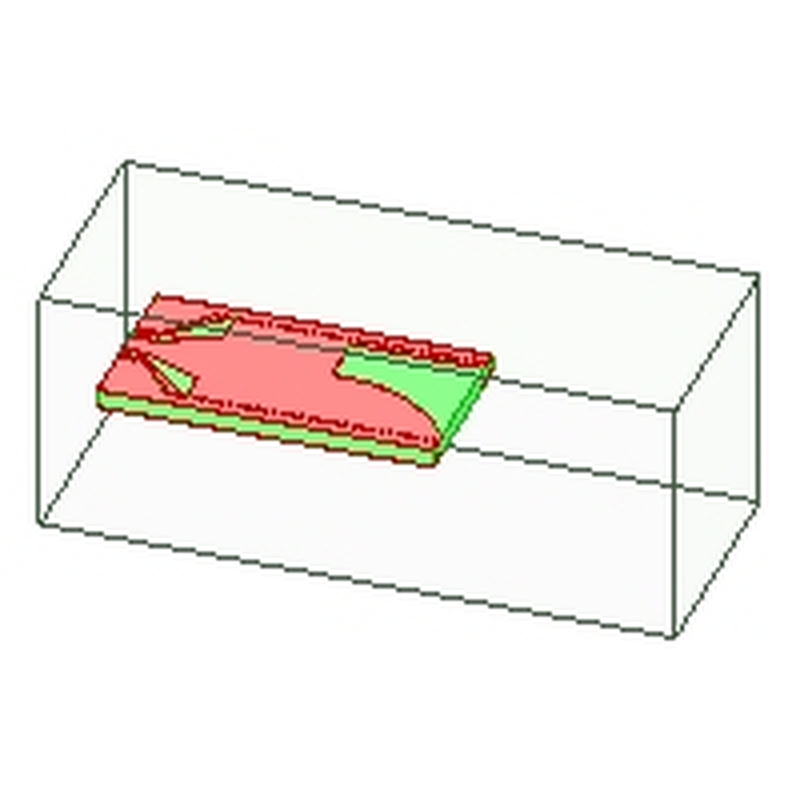
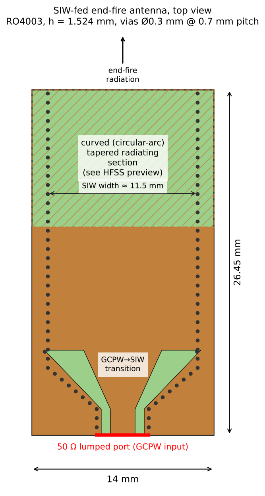

# SIW-Fed End-Fire Antenna, X-Band (HFSS)

[← Back to HFSS Simulations](../README.md)

**Application:** A compact planar end-fire antenna for X-band radar, satellite and point-to-point wireless links.
The substrate-integrated-waveguide (SIW) feed gives low loss, easy integration with planar circuits, and a natural building block for arrays.

## Specifications

| Parameter | Value |
|---|---|
| Structure | GCPW input → tapered GCPW-to-SIW transition → SIW → curved (circular-arc) tapered radiating section |
| Overall dimensions | 14 mm × 26.45 mm × 1.524 mm (board), 35 µm copper |
| Substrate | Rogers RO4003, εr = 3.55, tanδ = 0.0027, h = 1.524 mm |
| SIW | Width ≈ 11.5 mm (via centre to centre), vias Ø 0.3 mm, pitch 0.7 mm |
| GCPW feed | Signal width 1.9 mm, gaps 0.7 mm |
| Excitation | 50 Ω lumped port at the GCPW input |
| Frequency range | 7–13 GHz, X band (extending into upper C and lower Ku); adaptive mesh at 10 GHz |
| SIW mode range | TE10 cutoff ≈ 7.0 GHz, TE20 cutoff ≈ 14.1 GHz (single-mode over the sweep) |
| Simulated outputs | S11, VSWR, realized gain vs frequency, 2D and 3D radiation patterns |
| Year of design | 2018 (last saved in ANSYS Electronics Desktop 2020 R2) |

## Source file (download to simulate)

| File | Description |
|---|---|
| [`SWI.aedt`](SWI.aedt) | ANSYS Electronics Desktop project (ACIS geometry) |

Open it with ANSYS HFSS / Electronics Desktop. The geometry uses the ACIS kernel, so AEDT 2025 R1 and later cannot open it directly: open and save it once in AEDT 2024 R2 (or earlier) to convert it to Parasolid. Simulation results are not included; re-run the analysis setup to regenerate them.
