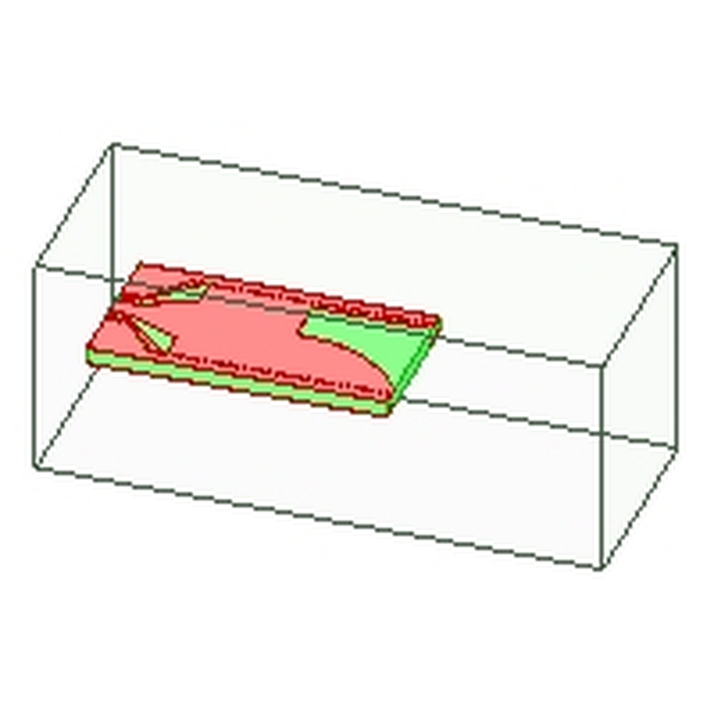

# Antenna Design Portfolio

RF and antenna design models simulated in ANSYS HFSS, including Ka-band phased arrays for satellite communications.

- [Antenna Design](Antenna-Design/)
  - [HFSS Simulations](Antenna-Design/HFSS-Simulations/)
    - [Ka-band CP phased array 16×16, satellite communications](Antenna-Design/HFSS-Simulations/Ka-Band-CP-Array-16x16/) – 16–21 GHz (Ka)
    - [Ka-band CP phased array 8×8, satellite communications](Antenna-Design/HFSS-Simulations/Ka-Band-CP-Array-8x8/) – 16–21 GHz (Ka)
    - [SIW-fed end-fire antenna](Antenna-Design/HFSS-Simulations/SIW-Antenna/) – 7–13 GHz (X)
    - [Axial-mode helix (RHCP)](Antenna-Design/HFSS-Simulations/Helix-Antenna/) – 1.15–1.33 GHz (L)
    - [Log-periodic dipole array](Antenna-Design/HFSS-Simulations/Log-Periodic-Dipole-Array/) – 54–216 MHz (VHF)
    - [Half-wave dipole](Antenna-Design/HFSS-Simulations/Half-Wave-Dipole/) – 0.9 GHz (UHF)
    - [Quarter-wave monopole](Antenna-Design/HFSS-Simulations/Quarter-Wave-Monopole/) – 0.9 GHz (UHF)
    - [Coaxial line](Antenna-Design/HFSS-Simulations/Coaxial-Line/) – 1–5 GHz (L/S/C)
    - [Rectangular waveguide](Antenna-Design/HFSS-Simulations/Rectangular-Waveguide/) – 2–10 GHz (S/C/X)

