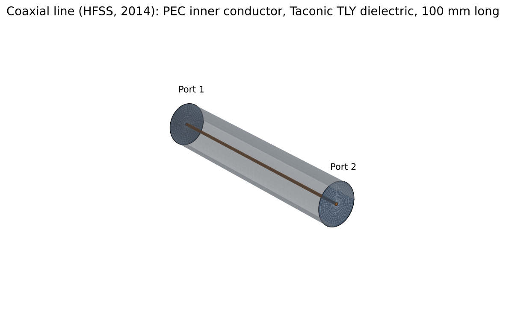
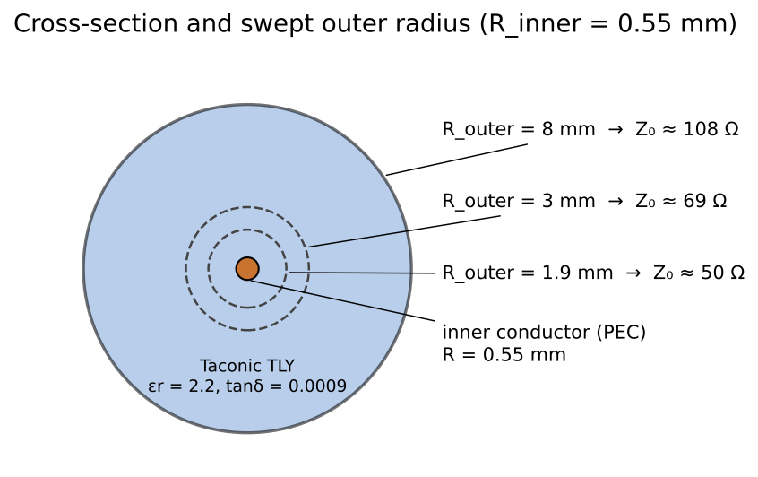

# Coaxial Transmission Line (HFSS)

[← Back to Transmission Line](../README.md)

**Application:** A two-port coaxial line used as a model to study how the conductor radii set the characteristic impedance and the 50 Ω match.
Coaxial lines like this are standard RF interconnects and antenna feed lines in communication and test equipment.

## Specifications

| Parameter | Value |
|---|---|
| Structure | Dielectric-filled coaxial line, PEC inner conductor, perfect-E outer wall |
| Overall dimensions | Length 100 mm; outer diameter 16 mm (nominal), swept to 6 mm and 3.8 mm |
| Inner conductor | Radius 0.55 mm (Ø 1.1 mm) |
| Outer radius (parametric) | 1.9 mm (Z₀ ≈ 50 Ω), 3 mm (Z₀ ≈ 69 Ω), 8 mm (Z₀ ≈ 108 Ω) |
| Dielectric | Taconic TLY, εr = 2.2, tanδ = 0.0009 |
| Excitation | Two wave ports, renormalized to 50 Ω |
| Frequency range | 1–5 GHz (L, S and lower C bands); adaptive mesh at 3 GHz |
| Single-mode limit | TE11 cutoff ≈ 7.5 GHz (largest case), so the sweep is single-mode (TEM) |
| Year of design | 2014 (HFSS 14) |

Z₀ values come from Z₀ = (60/√εr)·ln(R_outer/R_inner).

## Source file (download to simulate)

| File | Description |
|---|---|
| [`coaxial_line.hfss`](coaxial_line.hfss) | legacy HFSS project (HFSS 14/15, ACIS geometry) |

Open it with ANSYS HFSS / Electronics Desktop. The geometry uses the ACIS kernel, so AEDT 2025 R1 and later cannot open it directly: open and save it once in AEDT 2024 R2 (or earlier) to convert it to Parasolid. Simulation results are not included; re-run the analysis setup to regenerate them.
