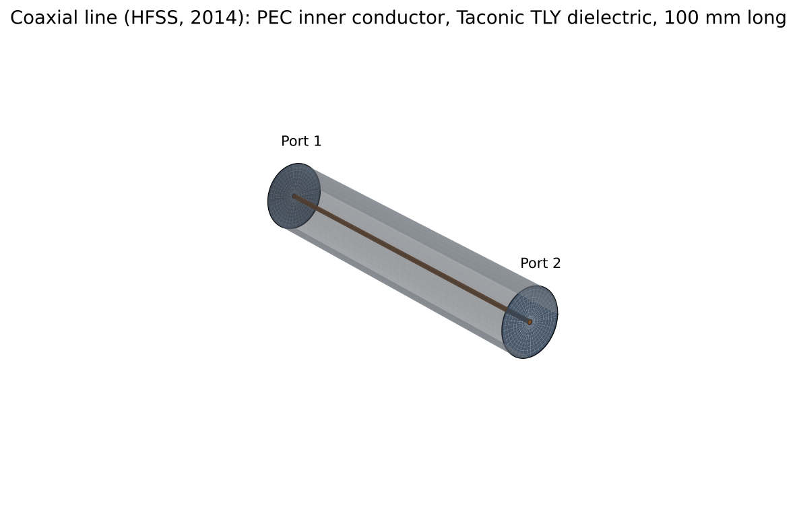
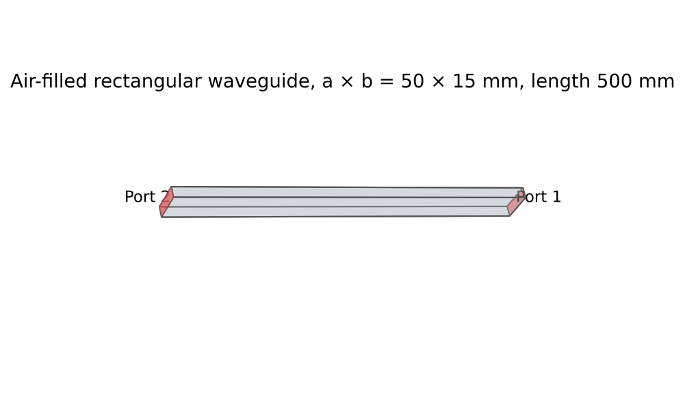

# Transmission Line (HFSS)

[← Back to repository home](../README.md)

RF transmission-line models simulated in ANSYS HFSS. Each folder has images of the model and a README with its full specifications.

| Model | Type | Frequency (band) | Solver | Year |
|---|---|---|---|---|
| [Coaxial line](Coaxial-Line/) | TEM line, impedance vs. conductor radii | 1–5 GHz (L/S/C) | HFSS (FEM) | 2014 |
| [Rectangular waveguide](Rectangular-Waveguide/) | Hollow waveguide, TE10 cutoff study | 2–10 GHz (S/C/X) | HFSS (FEM) | 2014 |

## Gallery

<table>
<tr><td align="center"> <a href="Coaxial-Line/">Coaxial line</a></td><td align="center"> <a href="Rectangular-Waveguide/">Rectangular waveguide</a></td></tr>
</table>
