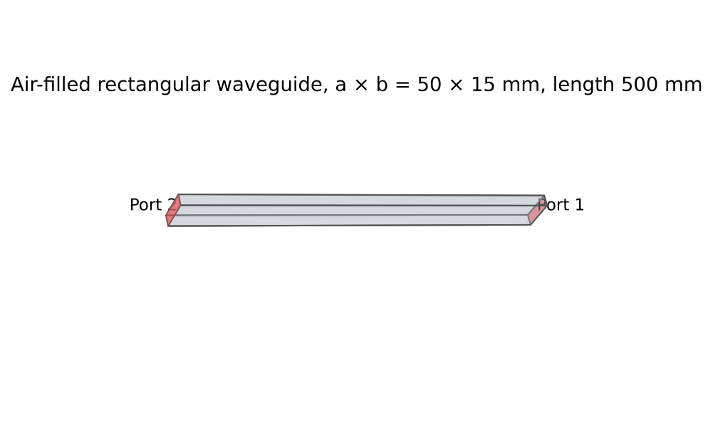
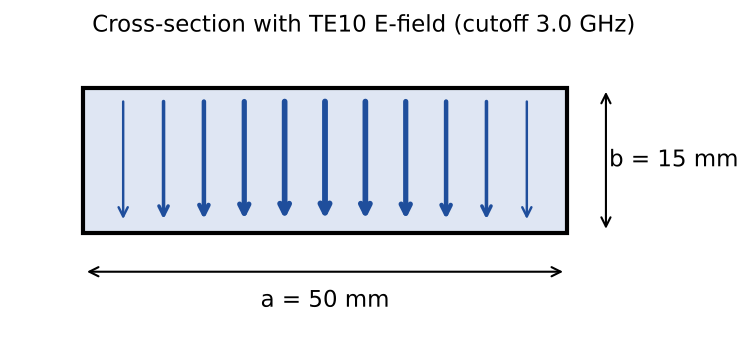

# Rectangular Waveguide (HFSS)

[← Back to Transmission Line](../README.md)

**Application:** An air-filled hollow metallic waveguide used to study cutoff and dominant-mode (TE10) propagation.
Waveguides like this carry high-power, low-loss microwave signals in radar, satellite ground stations and test systems.

## Specifications

| Parameter | Value |
|---|---|
| Structure | Air-filled rectangular waveguide with perfect-E walls |
| Overall dimensions | a × b = 50 mm × 15 mm cross-section, length 500 mm |
| Excitation | Two wave ports at the ends |
| Mode cutoffs | TE10 3.0 GHz, TE20 6.0 GHz, TE01 10.0 GHz |
| Frequency range | 2–10 GHz (S, C and lower X bands); adaptive mesh at 6 GHz |
| Simulated outputs | S21 (transmission), showing cutoff below 3 GHz |
| Year of design | 2014 (HFSS 14) |

## Source file (download to simulate)

| File | Description |
|---|---|
| [`waveguide.hfss`](waveguide.hfss) | legacy HFSS project (HFSS 14/15, ACIS geometry) |

Open it with ANSYS HFSS / Electronics Desktop. The geometry uses the ACIS kernel, so AEDT 2025 R1 and later cannot open it directly: open and save it once in AEDT 2024 R2 (or earlier) to convert it to Parasolid. Simulation results are not included; re-run the analysis setup to regenerate them.
